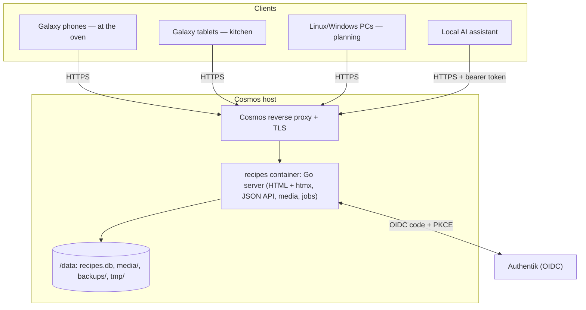

# 01 — Specification Index

Implementation-ready specification of the **Ninja Woodfire Recipe Keeper**. It is written so that an engineer or an
AI model can implement the system without further context.

## Documents

| # | Document | Audience | Contents |
|---|---|---|---|
| 00 | [00-brief.md](00-brief.md) | everyone | The owner's original requirements (never edited) |
| — | [open-questions.md](open-questions.md) | everyone | Decisions log (changes to the brief) and remaining open questions |
| 10 | [10-user-stories.md](10-user-stories.md) | everyone | Personas, stories with acceptance criteria, wording, Must/Nice |
| 20 | [20-architecture.md](20-architecture.md) | architect, Go | System design, auth, authz, security, images, i18n, search, config, CLI, Taskfile |
| 25 | [25-oven-settings.md](25-oven-settings.md) | Go, UI | Ninja Woodfire OO101UK modes, stage fields, validation table, labels |
| 30 | [30-data-model.md](30-data-model.md) | Go | SQLite schema, migrations, lifecycle/deletion rules, derived values |
| 40 | [40-api.md](40-api.md) | Go, UI, assistant | Every HTML route and JSON endpoint, payloads, errors |
| 50 | [50-deployment-cosmos.md](50-deployment-cosmos.md) | operator | Dockerfile, dev stack, Cosmos, Authentik, backup/restore/upgrade |
| 60 | [60-backend-golang.md](60-backend-golang.md) | Go | Dependencies, code rules, error handling, view models, tests |
| 70 | [70-ui-frontend.md](70-ui-frontend.md) | UI | Screens, permission flags per screen, client JS, timers, uploads, drafts, PWA, device checklist |

## Single source of truth

Each concept is defined in **exactly one** document. Other documents link to it and must not restate it. When you
change a concept, change it only in its owning document.

| Concept | Canonical in |
|---|---|
| Requirements, personas, wording | `10` (+ decisions in `open-questions.md`) |
| Env vars, CLI subcommands, Taskfile targets | `20 §12, §17, §18` |
| Authentication, sessions, tokens | `20 §5–§6` |
| Authorization rules | `20 §7` |
| Security headers, CSP, upload limits, input limits, SSRF | `20 §8` |
| Image processing and storage layout | `20 §9` |
| Search semantics and normalization | `20 §11` |
| Events and LLM hook | `20 §15` |
| Oven modes, stage fields, validation, oven labels | `25` |
| Tables, columns, constraints, seed data, deletion rules | `30` |
| URLs, methods, request/response formats, status codes | `40` |
| Assistant integration: duplicate rules, outcomes, brief, OpenAPI, MCP | `40 §4, §7–§9` |
| Docker image, compose files, Cosmos, Authentik, backup/restore procedures | `50` |
| Dependencies, code structure, tests | `60` |
| Screens, per-screen permission flags, client behaviour, PWA | `70` |

If two documents still disagree, the canonical one wins and the other is a bug to fix.

## Architecture overview

