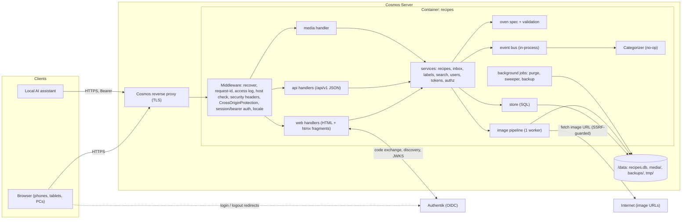

# 20 — System Architecture

Owner: Architect. Inputs: `00-brief.md`, decisions in `open-questions.md`.
Status: **canonical** for: system shape, middleware, authentication, authorization rules, security controls,
image pipeline, i18n mechanics, search semantics, configuration (env vars), CLI subcommands, Taskfile targets,
events/LLM hook, backups (app side), non-functional targets.
Not here: schema (`30`), routes and payloads (`40`), oven rules (`25`), Cosmos/Authentik operations (`50`),
Go code conventions and tests (`60`), screens and client JS (`70`).

## 1. Summary of decisions

| Topic | Decision |
|---|---|
| Shape | **One Go binary, one container.** It serves server-rendered HTML, static assets, media and a JSON API |
| UI | Go `html/template` + **htmx 2.x** (vendored) + small vanilla-JS modules. No SPA, no Node build step, no CDN |
| Router | Go stdlib `net/http.ServeMux` with **method + path patterns** (`"POST /recipes/{id}/edit"`). Hand-written middleware |
| Go version | 1.25+ (for `http.CrossOriginProtection`). Exact version pinned in `go.mod` and `Dockerfile` |
| DB | SQLite via **`modernc.org/sqlite`** (pure Go, `CGO_ENABLED=0`), WAL, file in `/data` |
| Migrations | **`github.com/pressly/goose/v3`**, embedded SQL, run at startup |
| Search | Categories (fixed, translated, many per recipe) + free tags + oven facets + **FTS5 `trigram`** |
| Auth (browser) | OIDC Authorization Code + **PKCE (S256)** + client secret against Authentik via `github.com/coreos/go-oidc/v3` + `golang.org/x/oauth2`. Opaque server-side sessions in SQLite |
| Auth (assistant) | Per-user **bearer API tokens** (random, shown once, SHA-256 at rest), scoped |
| CSRF | `http.CrossOriginProtection` + `SameSite=Lax` cookie + POST-only mutations |
| Images | Browser resizes before upload; server accepts **JPEG, PNG, WebP only** (HEIC rejected with a friendly message), re-encodes to JPEG `full` + `thumb`, strips metadata. Files under `/data/media`, served by an authz-checking handler |
| Image libs | stdlib `image/jpeg`, `image/png`; `golang.org/x/image/webp`, `golang.org/x/image/draw` (CatmullRom); `github.com/rwcarlsen/goexif/exif` (orientation only) |
| i18n | `github.com/nicksnyder/go-i18n/v2`, embedded TOML `en`, `he`. RTL via `<html dir>` + CSS logical properties |
| Logging | `log/slog`, JSON to stdout |
| Config | Environment variables only (§12) |
| LLM hook | `categorize.Categorizer` interface + durable "not yet categorized" marker + in-process events. v1 = no-op |
| Build | Taskfile v3 (§18); multi-stage Dockerfile → `gcr.io/distroless/static-debian12:nonroot` |

### Why server-rendered + htmx
- **One deployable, one language**: no JS toolchain or npm supply chain; suits a household app on Cosmos.
- **Simpler, safer auth**: pure cookie session, backend is the OIDC client; no tokens in the browser, no CORS.
- **Fast on the Galaxy Tab S6 Lite**: first paint from HTML, no hydration. JS budget: htmx (~16 KB gzip) + app modules ≤ 10 KB gzip.
- **Enough interactivity**: htmx covers live search, favourites, visibility toggle, inbox actions, pagination. The editor, cook mode (timers, wake lock) and photo upload use vanilla JS.
- **Progressive enhancement**: browsing, search, recipe view, inbox actions and settings work without JS. The editor and cook mode require JS (acceptable for the listed browsers).

## 2. Component diagram



Layering rule: handlers → services → store. Handlers never run SQL and never decide authorization themselves;
they call service methods (which enforce authz) and `authz` predicates (to decide what to *show*).
Services own transactions, validation, FTS maintenance and event publishing.

## 3. Repository layout

```
/cmd/recipes/main.go          # subcommands (§17)
/internal/config/             # env parsing + validation (fail fast)
/internal/db/                 # Open(reader, writer), pragmas, goose runner, version guard
/internal/db/migrations/      # 0001_initial_schema.sql, 0002_seed_categories.sql (embedded)
/internal/store/              # repositories (one file per aggregate)
/internal/domain/             # plain structs + enums
/internal/oven/               # spec.go (table), validate.go, derive.go
/internal/service/            # recipes, inbox, search, labels, users, tokens, images
/internal/authz/              # pure predicates (§7)
/internal/auth/               # oidc.go, session.go, bearer.go, middleware.go
/internal/images/             # decode/orient/resize/encode, fetch (SSRF guard), storage paths, sweeper
/internal/events/             # Bus, event types
/internal/categorize/         # Categorizer interface, Noop
/internal/i18n/               # bundle, per-request Localizer, template funcs, i18ncheck tool
/internal/web/                # HTML handlers, view models, form parsing, flash
/internal/api/                # JSON handlers, problem+json, DTOs
/internal/httpx/              # generic middleware
/web/templates/               # layout.html, pages/*.html, partials/*.html
/web/static/                  # css/, js/, vendor/htmx.min.js, icons/, manifest.webmanifest, sw.js
/locales/en.toml, he.toml
/deploy/dev/                  # docker-compose.yml, .env.example, authentik blueprint, mock-oidc config (50 §4)
/deploy/cosmos/               # cosmos-compose.json, README.md (50 §5)
/test/                        # end-to-end tests (60 §6)
/docs/specs/
Dockerfile, .dockerignore, Taskfile.yml, .golangci.yml, go.mod
```

Static assets are served at `/static/{version}/...` (`{version}` = git short SHA, `dev` in development) with
`Cache-Control: public, max-age=31536000, immutable` (`no-cache` when `APP_ENV=development`).
`/manifest.webmanifest` and `/sw.js` are served at fixed root paths with `Cache-Control: no-cache`.

## 4. HTTP server and middleware

Order (outermost first): `Recover` → `RequestID` (`X-Request-Id`; generate a ULID if missing or not `[A-Za-z0-9-]{1,64}`)
→ `AccessLog` → `HostCheck` → `SecurityHeaders` → `CrossOriginProtection` (non-`/api/` paths) → `Auth`
(session for HTML; bearer for `/api/v1`; both for `/media`) → `Locale` → mux.

- **HostCheck**: requests whose `Host` differs from the host of `APP_BASE_URL` get 400, except `/healthz` and `/readyz`.
- **Client IP**: the TCP peer, unless the peer is inside `APP_TRUSTED_PROXIES`; then the right-most `X-Forwarded-For`
  entry that is not itself in `APP_TRUSTED_PROXIES`. Used for logs and rate limiting only.
- Scheme, host and every absolute URL come from `APP_BASE_URL`, never from `X-Forwarded-*` or `Host`.
- Timeouts: `ReadHeaderTimeout 10s`, `ReadTimeout 120s`, `WriteTimeout 120s`, `IdleTimeout 120s`.
- Shutdown: on SIGTERM stop accepting, drain for at most **8 s**, run `PRAGMA wal_checkpoint(TRUNCATE)`, close the DB,
  exit 0. (Docker's default stop grace period is 10 s.)
- Startup must not depend on Authentik being reachable: OIDC discovery is loaded lazily and retried with backoff;
  `/auth/login` returns a friendly 503 page ("Sign-in is temporarily unavailable") until discovery succeeds.

## 5. Authentication: browser (Authentik OIDC)

### 5.1 Provider setup
Operational steps are in `50 §6`. The app needs: confidential client, redirect URI `${APP_BASE_URL}/auth/callback`,
RS256 signing key, scopes `openid email profile` (Authentik's default `profile` mapping includes `groups`),
post-logout redirect `${APP_BASE_URL}/auth/logged-out`. The app sends PKCE S256 **and** the client secret.

### 5.2 Login flow
1. Unauthenticated page requests go to `GET /signin?return_to=…` (`40 §1`), a friendly app page with one big
   "Sign in" button and a language switch (story A1-AC3, I1-AC1). The button links to `/auth/login?return_to=…`.
2. `GET /auth/login`: validate `return_to` (`40 §1`). Generate `state` (32 random bytes, base64url), `nonce` (32 B),
   `verifier = oauth2.GenerateVerifier()`. Insert into `oidc_login_states` with `expires_at = now + 10 min`.
   302 to `AuthCodeURL(state, oauth2.S256ChallengeOption(verifier), oidc.Nonce(nonce))`.
3. `GET /auth/callback`: if the IdP sent `error` → the "not allowed" page (403) for `access_denied`, otherwise the
   "sign-in failed, try again" page (400). Look up and **delete** the state row (single use). Missing/expired →
   400 "Sign-in took too long — try again" with a button.
4. `Exchange(ctx, code, oauth2.VerifierOption(verifier))`, verify the ID token (go-oidc checks iss/aud/exp/signature),
   check `nonce`.
5. Claims mapping:

   | Claim | Use |
   |---|---|
   | `iss` + `sub` | Identity key `(users.oidc_issuer, users.oidc_subject)` |
   | `email` | `users.email` (refreshed each login, informational, not unique) |
   | `name`, else `preferred_username`, else `email` | `users.display_name` (refreshed each login) |
   | `OIDC_GROUPS_CLAIM` (string array) | If `OIDC_ALLOWED_GROUPS` is set and there is no overlap → **"not allowed" page, 403** ("You can't get in yet. Ask Lior to add you."). `is_admin = OIDC_ADMIN_GROUP ∈ groups` (refreshed each login) |
   | `locale` (optional) | Initial `users.ui_language` if it starts with `he`/`en` and the user has not chosen one |

   The app's group check is the **primary** access gate, so denied users see the friendly page. An Authentik
   policy binding is optional defence in depth (`50 §6.5`); when used, Authentik shows its own denial page instead.
6. Provisioning: upsert on `(oidc_issuer, oidc_subject)`; first login creates the user with a new UUID.
   `ui_language` from the claim, else the `lang` cookie, else `Accept-Language`, else NULL. Set `last_login_at`.
7. Create a session (§5.3), set the cookie, `303 return_to`.

### 5.3 Sessions
- Cookie `__Host-nwr_session` (dev over `http://`: `nwr_session`), value 32 random bytes base64url.
  Flags `HttpOnly; Secure (https only); SameSite=Lax; Path=/`; `Max-Age` = remaining absolute lifetime.
- Stored as `sessions.id_hash = hex(SHA-256(token))`; the raw token is never stored. No signing key is involved,
  so there is no session-secret env var and server restarts never log anyone out.
- Lifetime: idle timeout `SESSION_IDLE_TTL` (default 30 days), absolute `SESSION_MAX_TTL` (default 365 days).
  On each authenticated request, if `last_seen_at` is older than 10 min, set `last_seen_at = now` and
  `expires_at = min(now + idle, created_at + max)`.
- Hourly job deletes expired sessions and login states.
- Sessions are independent of the IdP session. Disabling a user in Authentik blocks new logins only;
  `recipes user revoke-sessions <user>` ends existing ones.

### 5.4 Logout
`POST /auth/logout`: delete the session row, clear the cookie, 302 to the discovered `end_session_endpoint` with
`id_token_hint` and `post_logout_redirect_uri=${APP_BASE_URL}/auth/logged-out`; without an endpoint, 302 to
`/auth/logged-out` directly.

### 5.5 Development
`deploy/dev` runs a real Authentik (default) or `ghcr.io/navikt/mock-oauth2-server` (profile `mock`) (`50 §4`).
The real code path is always used: **the binary has no auth-bypass flag or dev-login route.**

## 6. Authentication: AI assistant (API tokens)

- Created at `/settings/tokens`: name, scopes, expiry (never / 30 / 90 / 365 days). Max 10 active tokens per user.
- Format `nwr_` + 32 random bytes base62 (~43 chars), shown once. Stored: `token_hash = hex(SHA-256(full token))`,
  `token_prefix` = first 8 chars after `nwr_`, scopes, `expires_at`, `revoked_at`, `last_used_at` (updated ≤ 1/min).
- `Authorization: Bearer nwr_…`; lookup by hash. Reject (401) when unknown, revoked, expired, or the user is gone.
- Scopes: `inbox:write` (submit, list, withdraw own inbox items), `recipes:read` (read recipes visible to the user,
  their images, categories). New tokens default to both.
- Tokens act as their user with the same authz, but can never accept/reject, edit, share or delete (browser-only).
- Rate limit: in-memory token bucket per token, `API_RATE_LIMIT_PER_MIN` (default 60) with burst 20 → 429 + `Retry-After`.

## 7. Authorization rules

Actor = session user or token user. Predicates live in `internal/authz` as pure functions with table-driven tests.

| Predicate | `status=inbox` | `active` + `private` | `active` + `shared` |
|---|---|---|---|
| `CanView` | owner | owner | **every user** |
| `CanEdit` | owner | owner | **every user** |
| `CanDelete` | owner (= reject) | owner | **every user** |
| `CanChangeVisibility` | — (accept first) | owner (share) | owner (unshare); nobody if `owner_id IS NULL` |
| `CanAcceptReject` | owner | — | — |
| `CanCopy` | — | owner | every user |
| `CanFavourite`, `CanLogCook` | — | owner | every user |
| Delete a cook-log entry | — | its author | its author |

- This is the owner's decision 1.1 ("full control of shared recipes is ceded to the family"). Only visibility is
  reserved to the owner, so nobody can make a recipe disappear from the family by turning it into someone else's
  private recipe; deleting it is possible and is guarded by the strong confirmation (`70 §4.6`).
- **Admins** (`is_admin`) manage the category list (`/admin/categories`). They have no extra power over recipes and
  cannot see other users' private recipes or inboxes.
- Not viewable → 404; viewable but action not allowed → 403.
- Images inherit the recipe's `CanView`. Tag suggestions only include tags used on recipes the actor can view.
- **View models**: every page that shows an action button receives the matching boolean computed from these
  predicates (`CanEdit`, `CanDelete`, `CanChangeVisibility`, `CanCopy`, `IsFavourite`, …). Templates never
  reimplement the rules. The required flags per page are listed in `70 §4`.

## 8. Security controls

- **CSRF**: `http.CrossOriginProtection` on all non-API routes, with `APP_BASE_URL`'s origin trusted. POST-only
  mutations; `SameSite=Lax`. The API never accepts the session cookie, so it is exempt.
- **Security headers** on HTML responses:
  - `Content-Security-Policy: default-src 'self'; script-src 'self'; style-src 'self'; img-src 'self' data: blob:; connect-src 'self'; font-src 'self'; worker-src 'self'; manifest-src 'self'; object-src 'none'; base-uri 'none'; frame-ancestors 'none'; form-action 'self' <OIDC issuer origin>`
  - **No `'unsafe-inline'`, no external hosts.** Templates contain no inline `<script>` code, no `on*=` attributes
    and no `style=` attributes. JS behaviour is attached by event delegation on `data-action` attributes (`70 §2`).
    htmx config: `<meta name="htmx-config" content='{"includeIndicatorStyles":false,"allowEval":false,"allowScriptTags":false}'>`.
    Server data for JS goes in `<script type="application/json">` blocks.
  - `X-Content-Type-Options: nosniff`, `Referrer-Policy: same-origin`,
    `Permissions-Policy: camera=(self), geolocation=(), microphone=(), screen-wake-lock=(self)`,
    `Cross-Origin-Opener-Policy: same-origin`, `Strict-Transport-Security: max-age=31536000` when https.
- **Output encoding**: `html/template` only. Recipe text is plain text rendered with `white-space: pre-line`;
  no Markdown/HTML input in v1.
- **Uploads**: `http.MaxBytesReader` on every body. Browser image upload: one file per request,
  `MAX_IMAGE_MB` (default 15). Form posts without files: 1 MB. API JSON body: `API_MAX_BODY_MB` (default 40).
  Type by magic bytes (`http.DetectContentType` plus WebP `RIFF….WEBP` check): JPEG, PNG, WebP. HEIC/HEIF
  (`ftypheic`, `ftypheix`, `ftypmif1`, `ftyphevc`), GIF, SVG and everything else → 415 with a localized message
  ("This photo format isn't supported. On Samsung: Camera settings → Advanced picture options → turn off
  High efficiency pictures."). Pixel cap `IMAGE_MAX_PIXELS` (default 50 MP) checked via `image.DecodeConfig` first.
- **SSRF guard** for API image URLs: `https` only (plus `http` if `IMAGE_FETCH_ALLOW_HTTP=true`). Every resolved IP must
  be public: reject loopback, RFC 1918, link-local, CGNAT 100.64/10, ULA fc00::/7, multicast, unspecified,
  IPv4-mapped/NAT64 forms of those. Enforced in `net.Dialer.Control` (defeats DNS rebinding). ≤ 3 redirects, each
  re-checked. Timeout `IMAGE_FETCH_TIMEOUT`. Body cap `MAX_IMAGE_MB`. `User-Agent: ninja-recipes/<version>`.
- **Input limits** (server-side; also HTML `maxlength`): title ≤ 200, description ≤ 2000, notes ≤ 8000,
  ingredient line ≤ 300, step ≤ 4000, ≤ 100 ingredients, ≤ 100 steps, ≤ 10 stages, stage notes ≤ 500,
  pellet note ≤ 60, ≤ 5 categories, ≤ 20 tags, tag ≤ 40 chars, cook-log note ≤ 2000, source URL ≤ 2000,
  `MAX_IMAGES_PER_RECIPE` (default 10; counts recipe photos only, not cook-log photos).
- **Secrets**: `OIDC_CLIENT_SECRET` or `OIDC_CLIENT_SECRET_FILE` (exactly one). Never logged; the startup config
  dump redacts it. Tokens, cookies, `Authorization` headers and OAuth `code`/`state` query values are never logged.
- **Container**: UID 65532, read-only root filesystem, only `/data` writable. `TMPDIR=/data/tmp` (set in the
  Dockerfile) so multipart spill files and SQLite temp files work; `/data/tmp` is emptied at startup.
- **Caching of private media**: `Cache-Control: private, max-age=31536000, immutable`. Accepted consequence: after a
  recipe is unshared or deleted, its photos may remain in other family members' browser caches.

## 9. Images

- **Client side** (`70 §6.3`): the browser decodes the picked photo, applies orientation, scales it so the longest edge is
  ≤ 2048 px and uploads JPEG quality 0.85 (typically 300–800 KB instead of 5–12 MB over weak garden Wi-Fi). If the
  browser cannot decode the file (e.g. HEIC), it shows the HEIC message without uploading. The original file is
  uploaded unchanged only if canvas encoding fails for another reason.
- **Server pipeline** `images.Process(r io.Reader) (Processed, error)`: sniff type → `DecodeConfig` pixel cap → read EXIF
  Orientation (JPEG only; errors ignored) → decode → apply orientation → resize with `draw.CatmullRom` (never upscale)
  → flatten alpha onto white → encode JPEG. Variants:
  - `full`: longest edge ≤ 1600 px, quality 82
  - `thumb`: longest edge ≤ 480 px, quality 78 (not cropped; cards crop with CSS `object-fit: cover`)
- Re-encoding drops all EXIF/GPS. The original is not kept.
- **Concurrency**: processing runs under a global semaphore of `IMAGE_WORKERS` (default 1), so peak memory stays
  bounded (a 50 MP decode is ~200 MB RGBA; the container limit is 384 MiB, `50 §5.8`). Waiting requests block up to
  60 s, then 503 "Busy, try again".
- **Storage**: `${APP_DATA_DIR}/media/{key[0:2]}/{key}/{full|thumb}.jpg`, `key` = 16 random bytes hex. Write to
  `${APP_DATA_DIR}/tmp`, fsync, `os.Rename` into place (same filesystem), then insert the DB row.
- **Serving**: `GET /media/{key}/{variant}` → look up by key → `CanView` on its recipe → `http.ServeContent` with
  `ETag: "{key}-{variant}"`. Missing file with an existing row → serve the embedded placeholder image (never 500).
- **Deletion**: files are removed **after** the DB transaction commits. Failures are logged. A nightly sweeper deletes
  media directories with no DB row that are older than 1 h, and tmp files older than 1 h.

## 10. Internationalization (EN/HE, RTL)

- Catalogs `locales/en.toml`, `locales/he.toml` (go-i18n v2), embedded. Message IDs are dotted (`recipe.edit.title`).
  Hebrew plurals use CLDR one/two/many/other.
- **No user-visible string literal in templates or Go handlers** except via `T`: this includes flash messages,
  confirmation-dialog texts, placeholders, `aria-label`s and error pages. `task i18n:check` fails if a key is missing in
  either catalog or referenced but undefined; code review rejects literals.
- Language resolution per request: (1) `users.ui_language`, (2) `lang` cookie, (3) `Accept-Language` via
  `golang.org/x/text/language.Matcher` over [en, he], (4) `APP_DEFAULT_LANG`. `POST /settings/language` updates both.
- Template helpers: `T`, `fmtDuration` (`m:ss` < 1 h, `h:mm` ≥ 1 h, plus words "1 h 30 min" variant), `fmtTemp` (`°C`),
  `fmtQty` (fractions ½ ¼ ¾ ⅓ ⅔, decimal comma/point per locale), `fmtDate`, `fmtAgo` ("3 weeks ago" / "לפני 3 שבועות").
  Times shown in `TZ`.
- **RTL**: `<html lang="he" dir="rtl">`. CSS logical properties only. Directional icons flip with
  `[dir=rtl] .icon-dir { transform: scaleX(-1) }`. Numbers, temperatures and times are wrapped in `<bdi>`.
- **Recipe content language** is independent of the UI language. `recipes.language` sets `lang`/`dir` on the recipe
  container; `und` uses `dir="auto"`. The editor pre-selects `he` when the title contains Hebrew letters, else `und`.
  Every user-entered text element carries `dir="auto"`.
- Category names come from `labels.name` / `labels.name_he`; oven labels from `25 §3`.
- Fonts: system stack, no webfonts.

## 11. Search

- **Taxonomy**: categories (seeded, translated, admin-managed, 0–5 per recipe), tags (free, 0–20 per recipe),
  oven facets derived from stages (mode, smoked, total time). See `30 §5, §7`.
- **Normalization** (identical for indexing and querying, `internal/service/search.go`): NFKC → lower-case →
  remove Hebrew niqqud/cantillation (U+0591–U+05C7) → **map Hebrew final letters to regular forms**
  (ך→כ, ם→מ, ן→נ, ף→פ, ץ→צ) → collapse whitespace. Without the final-letter mapping "עוף" would not match "עופות".
- **FTS**: `recipe_fts` (`30 §4`) with `trigram remove_diacritics 1` (needs SQLite ≥ 3.45; bundled by modernc ≥ 1.29).
  Columns: title, description, ingredients (`raw_text` joined), steps, labels (category names in both languages + tags),
  notes (`recipes.notes` + all cook-log notes).
- **Query building**: split the normalized query on whitespace. Terms of ≥ 3 runes become quoted FTS phrases
  (`"` doubled) AND-ed in `MATCH`. Terms of 1–2 runes add `AND (normalized_title LIKE ? OR labels_text LIKE ?)` against
  the FTS columns (`ESCAPE '\'`). Empty query → no FTS join.
- **Maintenance** (same transaction as the change): recipe create/update/accept, cook-log add/delete, category rename
  (re-index affected recipes), delete (remove row). `recipes reindex` rebuilds everything.
- **Visibility filter** is always applied in SQL: `status='active' AND (visibility='shared' OR owner_id = :actor)`.
- **Ranking**: `bm25(recipe_fts, 0, 10, 2, 3, 1, 4, 1)` (recipe_id, title, description, ingredients, steps, labels, notes)
  when `q` is set; other sorts per `40 §2.3`. Pagination is keyset on the sort key + `id`.
- **Filters**: `40 §2.3`. Inbox items never appear.
- Scale: < 10k recipes; p95 search < 50 ms on a Raspberry-Pi-class host.

## 12. Configuration (environment variables)

This table is the **only** definition of env vars. Compose files (`50`) use these names.

| Variable | Default | Req. | Description |
|---|---|---|---|
| `APP_BASE_URL` | — | **yes** | Public URL, no trailing slash, e.g. `https://recipes.example.com`. Redirects, absolute URLs, OIDC redirect URI, cookie `Secure`, trusted origin, Host check |
| `APP_LISTEN_ADDR` | `:8080` | | |
| `APP_DATA_DIR` | `/data` | | Holds `recipes.db`, `media/`, `backups/`, `tmp/` |
| `APP_DEFAULT_LANG` | `en` | | `en` or `he` |
| `APP_TRUSTED_PROXIES` | *(empty = none)* | | CIDR list whose `X-Forwarded-For` is honoured (§4) |
| `APP_ENV` | `production` | | `development` enables template/static reload from `APP_TEMPLATES_DIR`, `no-cache` static, text logs |
| `APP_TEMPLATES_DIR` | — | | Dev only: path to `./web` |
| `OIDC_ISSUER_URL` | — | **yes** | Authentik per-provider issuer, trailing slash exactly as in discovery |
| `OIDC_CLIENT_ID` | — | **yes** | |
| `OIDC_CLIENT_SECRET` / `OIDC_CLIENT_SECRET_FILE` | — | **yes (one)** | Both set → startup error |
| `OIDC_SCOPES` | `openid email profile` | | |
| `OIDC_GROUPS_CLAIM` | `groups` | | |
| `OIDC_ALLOWED_GROUPS` | *(empty = any user the IdP authenticates)* | | Comma list; primary access gate (§5.2) |
| `OIDC_ADMIN_GROUP` | `recipes-admins` | | Empty = no admins |
| `SESSION_IDLE_TTL` | `720h` | | |
| `SESSION_MAX_TTL` | `8760h` | | |
| `MAX_IMAGE_MB` | `15` | | Per uploaded/fetched image |
| `MAX_IMAGES_PER_RECIPE` | `10` | | |
| `IMAGE_MAX_PIXELS` | `50000000` | | |
| `IMAGE_WORKERS` | `1` | | Concurrent image decodes |
| `API_MAX_BODY_MB` | `40` | | |
| `API_RATE_LIMIT_PER_MIN` | `60` | | Per token |
| `IMAGE_FETCH_TIMEOUT` | `15s` | | |
| `IMAGE_FETCH_ALLOW_HTTP` | `false` | | |
| `LOG_LEVEL` | `info` | | `debug|info|warn|error` |
| `LOG_FORMAT` | `json` | | `json|text` |
| `BACKUP_AUTO` | `true` | | In-process daily backup |
| `BACKUP_AT` | `03:30` | | Local time (`TZ`) of the daily backup |
| `BACKUP_KEEP` | `7` | | Snapshots kept |
| `CATEGORIZER` | `noop` | | Only `noop` in v1 |
| `TZ` | `UTC` | | Display times, backup schedule, file names |
| `TMPDIR` | `/data/tmp` (set in Dockerfile) | | |
| `GOMEMLIMIT` | `300MiB` (set in compose) | | |

Parsed once at startup into a typed struct; invalid/missing required values → exit code 2 with a clear message.
Unknown `APP_*`/`OIDC_*` variables are logged as warnings (typo detection). The effective non-secret config is
logged at info level.

## 13. Logging, health, observability

- `slog` fields: `time, level, msg, request_id, method, path, status, duration_ms, bytes, client_ip, user_id`.
  Never: email, tokens, cookies, `Authorization`, query strings of `/auth/*`. Access log skips `/healthz`,
  `/readyz` and `/static/*` at info level.
- `GET /healthz` → `200 ok` while the process runs (no DB). **Docker `HEALTHCHECK` uses this** via the
  `recipes healthcheck` subcommand (GET `http://127.0.0.1${APP_LISTEN_ADDR}/healthz`, 2 s timeout, exit 0/1).
- `GET /readyz` → JSON `{"db":"ok","media":"ok","oidc":"ok|pending"}`; 200 if `db` and `media` are ok
  (`SELECT 1` within 1 s; media dir writable, cached 30 s), else 503. `oidc: pending` does not fail readiness.
- `recipes version` and the settings page show version, commit and build date (`-ldflags`).

## 14. Database runtime

- DSN: `file:${APP_DATA_DIR}/recipes.db?_pragma=foreign_keys(1)&_pragma=journal_mode(WAL)&_pragma=busy_timeout(5000)&_pragma=synchronous(NORMAL)&_txlock=immediate`
  (pragmas apply to every pooled connection).
- Two pools: **writer** `SetMaxOpenConns(1)` for all write transactions; **reader** `SetMaxOpenConns(4)`.
- Startup: migrations run before the listener opens. If `goose_db_version` is **higher** than the newest embedded
  migration → refuse to start (exit 3) with "database is newer than this binary". Migrations are forward-only
  (no `down` in production; `migrate down-to` is not offered).

## 15. LLM-categorization extension point (design only)

```go
package categorize

type RecipeSnapshot struct {
    ID, Language, Title, Description string
    Ingredients, Steps, OvenModes    []string
    Categories, Tags                 []string // current
}

type Suggestion struct {
    Categories []string // known category slugs only
    Tags       []string
    Confidence float64  // 0..1
    Model      string
}

type Categorizer interface {
    Suggest(ctx context.Context, r RecipeSnapshot, knownCategories, knownTags []string) (Suggestion, error)
}

type Noop struct{}
func (Noop) Suggest(context.Context, RecipeSnapshot, []string, []string) (Suggestion, error) { return Suggestion{}, nil }
```

- **Events** (`internal/events`): `RecipeCreated`, `RecipeUpdated`, `InboxItemReceived`, `InboxItemAccepted`,
  `RecipeDeleted`, each `{RecipeID, ActorID, At}`, published **after commit**. One worker goroutine, buffered channel
  of 100; when full, drop and log a warning. Events are a latency optimisation only — never the sole trigger.
- **Durable marker**: `recipes.categorized_at` is NULL for new or imported recipes. The future categorization worker
  processes rows with `categorized_at IS NULL` (on events, and on a periodic scan after restart), so nothing is lost
  when an event is dropped. v1 never sets it and registers no subscriber.
- **Future contract**: suggestions are written as `recipe_labels.source='llm'`; categories are only added, never
  removed; the UI marks LLM labels with ✨ and lets users remove them. No migration is needed.

## 16. Backups (app side)

- `recipes backup` (also run in-process daily at `BACKUP_AT` when `BACKUP_AUTO=true`): `VACUUM INTO
  '/data/backups/recipes-YYYYMMDDTHHMMSSZ.db'`, `PRAGMA integrity_check` on the result, write
  `recipes-<ts>.media.txt` (list of referenced storage keys), prune beyond `BACKUP_KEEP`. Safe while serving.
- Media files are immutable. Off-host copies take the snapshot first, then `media/` (`50 §8`); a file deleted in
  between renders as the placeholder (§9).
- Restore and upgrade procedures: `50 §8`.

## 17. CLI subcommands (`/app/recipes <cmd>`)

| Command | Purpose |
|---|---|
| `serve` (default) | Run the server (migrates first) |
| `healthcheck` | Docker health probe (§13) |
| `migrate status` / `migrate up` | Manual migration control |
| `reindex` | Rebuild `recipe_fts` |
| `backup [--out DIR]` | One snapshot now + prune |
| `user list` | ID, display name, email, admin, last login |
| `user revoke-sessions <id\|email>` | Delete all sessions of a user |
| `user delete <id> [--yes]` | User deletion procedure (`30 §3`); prints what will be deleted and asks unless `--yes` |
| `version` | Version, commit, build date |

Subcommands other than `serve`/`healthcheck`/`version` open the same DB file and can run while `serve` runs.

## 18. Taskfile targets (`Taskfile.yml`, v3)

Single Taskfile at the repo root; this list is canonical. Dev-stack details are in `50 §4`, image release in `50 §9`.

| Target | Does |
|---|---|
| `default` | `task --list` |
| `dev:init` | Create `deploy/dev/.env` from the example with random secrets (idempotent) |
| `dev:up` | Full dev stack: app container + local Authentik (`50 §4`) |
| `dev:up:mock` | App + mock-oauth2-server |
| `dev:run` | Start dev Authentik in compose, run `go run ./cmd/recipes serve` on the host with `APP_ENV=development`, `APP_TEMPLATES_DIR=./web`, `APP_DATA_DIR=./dev-data` |
| `dev:logs` / `dev:down` / `dev:reset` | Compose logs / stop / stop and delete volumes (prompts) |
| `build` | `CGO_ENABLED=0 go build -trimpath -ldflags "-s -w -X main.version={{.VERSION}} -X main.commit={{.COMMIT}} -X main.date={{.DATE}}" -o bin/recipes ./cmd/recipes` |
| `test` | `CGO_ENABLED=1 go test -race ./...` (race detector needs cgo and a C compiler; tests only) |
| `test:e2e` | End-to-end suite (`60 §6`) against `dev:up:mock` |
| `test:cover` | Coverage HTML to `bin/coverage.html` |
| `lint` | `golangci-lint run` + `task i18n:check` + `task csp:check` |
| `fmt` | `gofmt -s -w . && goimports -w .` |
| `i18n:check` | `go run ./internal/i18n/cmd/i18ncheck` |
| `csp:check` | Fails if any template contains `<script>` with inline code, an `on*=` attribute, `style=`, or an `http(s)://` script/style URL |
| `migrate:new -- NAME` | `goose -dir internal/db/migrations create NAME sql` |
| `vendor:htmx` | Download the pinned htmx version, verify its SHA-256, write `web/static/vendor/htmx.min.js` |
| `docker:build` | Local single-arch image |
| `docker:release VERSION=X.Y.Z` | Multi-arch build + push (`50 §9`) |
| `backup` | `docker compose … exec app /app/recipes backup` |
| `ci` | fmt check, lint, test, build, test:e2e |

## 19. Non-functional targets

- Responsive 360 px – 2560 px; breakpoints and touch targets in `70 §3`.
- First load on a mid-range phone over Wi-Fi < 1 s; HTML < 50 KB gzip excluding images.
- Household concurrency: ~10 users.
- Accessibility: semantic HTML, labels on every input, visible focus, WCAG 2.2 AA contrast (AAA for oven settings
  in cook mode).
