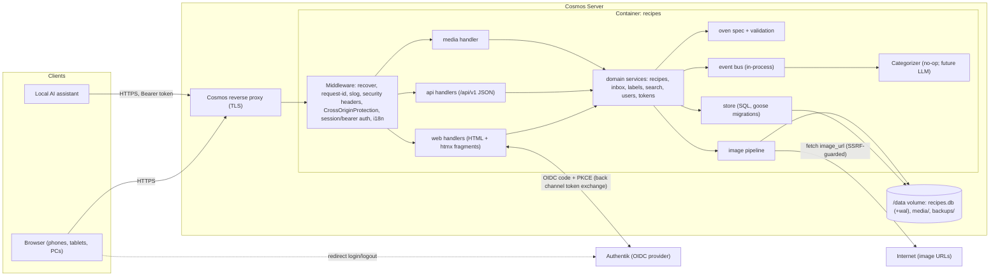

# 20 — System Architecture

Owner: Architect. Inputs: `00-brief.md`. Companion docs: `25-oven-settings.md`, `30-data-model.md`, `40-api.md`, `50-deployment-cosmos.md` (Cosmos admin), `10-user-stories.md`.

## 1. Summary of decisions

| Topic | Decision |
|---|---|
| Shape | **One Go binary, one container.** It serves server-rendered HTML, static assets, media, and a JSON API |
| UI | Go `html/template` + **htmx 2.x** + a small vanilla-JS module. No SPA, no Node build step |
| Router | Go stdlib `net/http.ServeMux` (method + path patterns, Go ≥ 1.22). Middleware is written by hand |
| Go version | 1.25+ (needed for `http.CrossOriginProtection`). Pin the exact version in `go.mod` / `Dockerfile` |
| DB | SQLite via **`modernc.org/sqlite`** (pure Go, `CGO_ENABLED=0`), WAL mode, file in `/data` volume |
| Migrations | **`github.com/pressly/goose/v3`**, SQL files embedded with `embed.FS`, run automatically at startup |
| Search | Fixed categories + free labels (structured filters) + **SQLite FTS5 `trigram`** full-text index |
| Auth (browser) | OIDC Authorization Code + **PKCE (S256)** against Authentik via **`github.com/coreos/go-oidc/v3`** + **`golang.org/x/oauth2`**. Server-side sessions in SQLite |
| Auth (AI assistant) | Per-user **bearer API tokens** (random, shown once, SHA-256 hashed at rest), scoped |
| CSRF | `http.CrossOriginProtection` (Fetch-Metadata/Origin) + `SameSite=Lax` cookie + POST-only mutations |
| Images | Filesystem under `/data/media`. Decode → auto-orient → resize → re-encode JPEG (this strips all EXIF). Served through an authz-checking handler |
| Image libs | stdlib `image/jpeg`, `image/png`; `golang.org/x/image/webp` (decode), `golang.org/x/image/draw` (CatmullRom resize); `github.com/rwcarlsen/goexif/exif` (orientation read only) |
| i18n | **`github.com/nicksnyder/go-i18n/v2`** with embedded TOML catalogs `en`, `he`. RTL through `<html dir>` + CSS logical properties |
| Logging | stdlib `log/slog`, JSON to stdout |
| Config | Environment variables only (§12) |
| LLM hook | `categorize.Categorizer` interface + in-process domain events. Default implementation is a no-op |
| Build tooling | Taskfile v3 (§16), multi-stage Dockerfile → `gcr.io/distroless/static-debian12:nonroot` |

### Why server-rendered + htmx instead of an SPA
- **One deployable, one language.** There is no JS toolchain, no npm supply chain, and no separate frontend container. That suits a household app on Cosmos.
- **Auth is simpler and safer.** It is a pure cookie session and the backend is the OIDC client. No tokens in the browser, no CORS, no refresh-token handling in JS.
- **Fast on low-end tablets.** The Galaxy Tab S6 Lite gets first paint from HTML with no hydration. Total JS is about 16 KB gzip (htmx) plus about 3 KB of app code.
- **Enough interactivity.** htmx covers live search filtering, inline inbox accept/reject, and partial swaps. The editor needs dynamic rows (ingredients/steps/stages) and a small vanilla-JS module using `<template>` cloning handles that.
- **Progressive enhancement.** Browsing, search, view, cook mode, inbox and settings work as plain links and forms without JS. The recipe editor needs JS for adding and reordering rows, which is acceptable for the listed browsers.

## 2. Component diagram



Layering rule: handlers → services → store. Handlers never run SQL. Services own transactions, authz checks, validation, FTS reindex, and event publishing.

## 3. Repository layout

```
/cmd/recipes/main.go          # subcommands: serve (default), migrate, reindex, backup, user, version
/internal/config/             # env parsing + validation (fail fast)
/internal/db/                 # Open(reader, writer), pragmas, goose runner
/internal/db/migrations/      # 0001_init.sql, ... (embedded)
/internal/store/              # repositories: users, sessions, recipes, ingredients, steps, stages, labels, images, tokens, fts
/internal/domain/             # plain structs + enums (Recipe, Ingredient, Step, OvenStage, Visibility, Status, ...)
/internal/oven/               # spec.go (mode table), validate.go, derive.go (+ tests)
/internal/service/            # recipes.go, inbox.go, search.go, labels.go, users.go, tokens.go, authz.go
/internal/auth/               # oidc.go (login/callback/logout), session.go, bearer.go, middleware.go
/internal/images/             # decode/orient/resize/encode, fetch (SSRF guard), storage paths
/internal/events/             # Bus, event types
/internal/categorize/         # Categorizer interface, Noop, Suggestion types
/internal/i18n/               # bundle loader, Localizer per request, template funcs
/internal/web/                # HTML handlers, view models, form parsing, flash messages
/internal/api/                # JSON handlers, problem+json, DTOs
/internal/httpx/              # middleware (security headers, request id, logging, recover, rate limit)
/web/templates/               # layout.html, partials/*.html, pages/*.html
/web/static/                  # css/app.css, js/app.js, vendor/htmx.min.js, icons/, manifest.webmanifest
/web/embed.go                 # //go:embed templates static
/locales/en.toml, he.toml     # embedded via /locales/embed.go
/deploy/                      # docker-compose.yml (dev), compose.cosmos.yml / cosmos servapp json (see 50-deployment)
/docs/specs/
Dockerfile, Taskfile.yml, .golangci.yml, go.mod
```

Static assets are served at `/static/{version}/...`, where `{version}` is the build's git short SHA. Response header `Cache-Control: public, max-age=31536000, immutable`.

## 4. HTTP server and middleware chain

Order (outermost first): `Recover` → `RequestID` (`X-Request-Id`, generate if missing) → `AccessLog` (slog) → `SecurityHeaders` → `CrossOriginProtection` (only for non-`/api/` paths) → `Auth` (session for HTML, bearer for `/api/v1`) → `Locale` → handler.

Server timeouts: `ReadHeaderTimeout 10s`, `ReadTimeout 60s` (uploads), `WriteTimeout 60s`, `IdleTimeout 120s`. Graceful shutdown on SIGTERM with a 20 s drain. The listener sits behind the Cosmos proxy. `APP_TRUST_PROXY=true` makes the app read `X-Forwarded-For` for the client IP in logs and rate limits. Scheme and host always come from `APP_BASE_URL`, never from request headers.

## 5. Authentication: browser (Authentik OIDC)

### 5.1 Authentik setup (documented in 50-deployment)
- Create an OAuth2/OpenID Provider, client type **Confidential**, redirect URI `${APP_BASE_URL}/auth/callback`, signing key RS256, scopes `openid email profile` (+ `groups` via the default "authentik default OAuth Mapping: OpenID 'profile'", which includes `groups`). Optionally limit access with an Authentik policy binding.
- The app uses **PKCE S256 together with the client secret** (defence in depth).

### 5.2 Login flow
1. `GET /auth/login?return_to=/recipes/12` (`return_to` must be a relative path starting with `/` and not `//`; otherwise use `/`).
2. Server generates `state` (32 random bytes, base64url), `nonce` (32 B), and `verifier = oauth2.GenerateVerifier()`. It inserts a row into `oidc_login_states(state, verifier, nonce, return_to, expires_at = now+10m)`.
3. 302 to `oauth2Config.AuthCodeURL(state, oauth2.S256ChallengeOption(verifier), oidc.Nonce(nonce))`.
4. `GET /auth/callback?code&state`: the server looks up the state and **deletes it** (single use). If it is missing or expired → 400 page "Login expired, try again" with a link. If the IdP sent an `error` parameter, render it.
5. `oauth2Config.Exchange(ctx, code, oauth2.VerifierOption(verifier))`, then `verifier.Verify(rawIDToken)` (go-oidc checks iss/aud/exp/signature), then check that `idToken.Nonce == nonce`.
6. **Claims mapping**:

   | Claim | Use |
   |---|---|
   | `iss` + `sub` | Immutable identity key (`users.oidc_issuer`, `users.oidc_subject`), unique together |
   | `email` | `users.email` (refreshed every login, informational) |
   | `name`, else `preferred_username`, else `email` | `users.display_name` (refreshed every login) |
   | `groups` (string array) | If `OIDC_ALLOWED_GROUPS` is set and there is no overlap → 403 page "Not authorized". `is_admin = OIDC_ADMIN_GROUP ∈ groups` (refreshed every login) |
   | `locale` (optional) | Initial `users.ui_language` if it is `he*`/`en*` and the user has not chosen one |

7. **Provisioning**: upsert the user on `(oidc_issuer, oidc_subject)`. A first login creates the user (no invite step), with `ui_language` from the claim, else `Accept-Language`, else `APP_DEFAULT_LANG`. Set `last_login_at`.
8. Create a session (§5.3), set the cookie, 302 to `return_to`.

### 5.3 Sessions
- The cookie `__Host-nwr_session` (falls back to `nwr_session` with no `__Host-` prefix when `APP_BASE_URL` is `http://`, i.e. dev) holds 32 random bytes, base64url. Flags: `HttpOnly; Secure (if https); SameSite=Lax; Path=/`.
- DB `sessions.id_hash = SHA-256(token)`. The row also stores `user_id`, `id_token` (for the logout hint), `created_at`, `last_seen_at`, `expires_at`, `user_agent`, `ip`.
- Lifetime: sliding idle timeout `SESSION_IDLE_TTL` (default 30 days, good for a household on phones). `last_seen_at`/`expires_at` are updated at most once per 10 min per session. Absolute max is `SESSION_MAX_TTL` (default 90 days). Expired rows are purged hourly by a background goroutine (it also purges expired `oidc_login_states`).
- Sessions are **not** tied to the IdP session after login. Disabling a user in Authentik blocks new logins. Existing sessions keep working until expiry; an admin can cut them with `recipes user revoke-sessions` (CLI).

### 5.4 Logout
`POST /auth/logout` (a form button, CSRF-protected): delete the session row, clear the cookie, then 302 to the provider's `end_session_endpoint` (from discovery) with `id_token_hint` and `post_logout_redirect_uri=${APP_BASE_URL}/auth/logged-out`. If discovery has no end-session endpoint, go to `/auth/logged-out` directly. `/auth/logged-out` is public and shows "Signed out" with a "Sign in" button.

### 5.5 Unauthenticated access
HTML routes other than `/auth/*`, `/healthz`, `/readyz`, `/static/*` and `/auth/logged-out` 302 to `/auth/login?return_to=<current path+query>`. For htmx requests (`HX-Request: true`) the response is 401 with an `HX-Redirect: /auth/login?...` header instead.

### 5.6 Development without Authentik
`deploy/docker-compose.yml` includes **`ghcr.io/navikt/mock-oauth2-server`** as a dev-only OIDC provider. The real code path is used, so there is **no auth-bypass flag in the binary**.

## 6. Authentication: AI assistant (API tokens)

- The user creates tokens at `/settings/tokens`: name (e.g. "Home assistant"), scopes (checkboxes), optional expiry (never / 30 / 90 / 365 days).
- Token format: `nwr_` + 32 random bytes in base62 (about 43 chars). It is shown **once**. Stored: `token_hash = SHA-256(full token)` (hex, unique index), `token_prefix` = first 8 characters after `nwr_` (displayed), scopes, `last_used_at`, `expires_at`, `revoked_at`.
- Request: `Authorization: Bearer nwr_...`. Lookup is by hash (a constant-time comparison is implicit in the indexed hash lookup). Reject when revoked, expired, or the owning user is missing. `last_used_at` is updated at most once per minute.
- Scopes: `inbox:write` (create/list/withdraw own inbox items) and `recipes:read` (read recipes visible to the user, for de-duplication). New tokens default to both.
- Tokens act **as their user** with the same authz rules. A token can never accept inbox items, share, or delete active recipes; those actions are browser-only by design.
- Rate limit: in-memory token bucket per token, 60 requests/min with burst 20 → 429 with `Retry-After`.
- Up to 10 active tokens per user.

## 7. Authorization rules

Actor = the session user (or the token's user for the API). Admins are users with `is_admin` from the `OIDC_ADMIN_GROUP` claim.

| Resource state | View | Edit | Delete | Share/Unshare | Accept/Reject | Copy to mine |
|---|---|---|---|---|---|---|
| `status=inbox` (always private) | owner | owner | owner (= Reject) | — (not allowed until accepted) | owner | — |
| `status=active, visibility=private` | owner | owner | owner | owner | — | owner |
| `status=active, visibility=shared` | **all users** | owner, admin | owner, admin | owner (unshare); admin (unshare) | — | all users |

- If a user cannot view a resource, every route for it returns **404**, not 403, so existence does not leak. If they can view but not modify it, they get 403.
- Images inherit the authz of their recipe (the media handler checks view permission).
- Label autocomplete only shows labels used on recipes the user can view.
- Admin powers are limited to moderating shared recipes. Admins **cannot** see other users' private recipes or inboxes.
- Authz lives in `service/authz.go` as pure functions, e.g. `CanView(user, recipe) bool`, with table-driven tests.

## 8. Security controls

- **CSRF**: `http.CrossOriginProtection` wraps all non-API routes. It rejects unsafe-method requests whose `Sec-Fetch-Site` is cross-site or whose `Origin` does not match the host. Add `APP_BASE_URL`'s origin as a trusted origin. All state changes are POST (HTML forms cannot send DELETE). Session cookie is `SameSite=Lax`. The bearer API skips this because it is not cookie-authenticated, and the API **never** accepts the session cookie.
- **Security headers** (all HTML responses):
  - `Content-Security-Policy: default-src 'self'; script-src 'self'; style-src 'self'; img-src 'self' data: blob:; connect-src 'self'; font-src 'self'; object-src 'none'; base-uri 'none'; frame-ancestors 'none'; form-action 'self' <OIDC issuer origin>`
  - No inline scripts or styles anywhere. Configure htmx with `<meta name="htmx-config" content='{"includeIndicatorStyles":false,"allowEval":false,"allowScriptTags":false}'>`. Indicator CSS lives in `app.css`. Server data for JS goes in `<script type="application/json">` blocks.
  - `X-Content-Type-Options: nosniff`, `Referrer-Policy: same-origin`, `Permissions-Policy: camera=(self), geolocation=(), microphone=()`, `Cross-Origin-Opener-Policy: same-origin`, and `Strict-Transport-Security: max-age=31536000` when https.
- **Output encoding**: `html/template` contextual escaping only. Recipe text is plain text rendered with `white-space: pre-line`. No Markdown or HTML input in v1, so there is no sanitizer.
- **Upload limits**: `http.MaxBytesReader`. Browser image upload: `MAX_IMAGE_MB` (default 15) per file, at most 5 files per request, so a request is capped at 5×MAX_IMAGE_MB + 1 MB. API inbox JSON body cap is `API_MAX_BODY_MB` (default 40, to fit base64 images). Image pixel cap is 40 MP, checked with `image.DecodeConfig` before a full decode (decompression-bomb guard). Allowed formats are detected by magic bytes (`http.DetectContentType`), not file extension: JPEG, PNG, WebP. Anything else (HEIC, GIF, SVG) → 415 with a localized message.
- **SSRF guard** for API `image_url`s: only `https` (and `http` if `IMAGE_FETCH_ALLOW_HTTP=true`). DNS is resolved and **every resolved IP must be public**; loopback, RFC1918, link-local, CGNAT 100.64/10, ULA fc00::/7, multicast and unspecified are rejected. Enforcement uses a custom `net.Dialer.Control` so DNS rebinding cannot bypass it. Max 3 redirects, each re-checked. Timeout `IMAGE_FETCH_TIMEOUT` (default 15 s). Body cap is MAX_IMAGE_MB. `User-Agent: ninja-recipes/<version>`.
- **Input limits** (server-side, also as HTML `maxlength`): title ≤ 200, description ≤ 2000, ingredient name ≤ 200, step text ≤ 4000, notes ≤ 8000, ≤ 100 ingredients, ≤ 100 steps, ≤ 10 stages, ≤ 20 labels per recipe, label ≤ 40 chars.
- **Secrets**: `OIDC_CLIENT_SECRET` can be supplied as `OIDC_CLIENT_SECRET_FILE` (a Docker secret). Secrets are never logged; the config dump redacts them.
- The container runs as non-root UID 65532 with a read-only root filesystem; only `/data` is writable.

## 9. Images

- **Storage**: `${APP_DATA_DIR}/media/{key[0:2]}/{key}/{variant}.jpg`, where `key` = 16 random bytes in hex (unguessable, though authz is still enforced). Variants:
  - `full`: longest edge ≤ 1600 px, JPEG quality 82
  - `thumb`: longest edge ≤ 480 px, JPEG quality 78 (cards/lists)
  
  The original upload is **not kept**, which saves space and removes metadata.
- **Pipeline** (`images.Process(r io.Reader) (Processed, error)`): sniff type → `DecodeConfig` pixel cap → read the EXIF Orientation (JPEG only, via goexif; ignore errors) → decode → apply the orientation (rotate/flip in Go) → resize with `draw.CatmullRom` (never upscale) → flatten alpha onto white → encode JPEG. Re-encoding **drops all EXIF/GPS** metadata. Write to a temp file in the same directory, then `os.Rename` (atomic).
- **DB**: `recipe_images(recipe_id, storage_key, position, width, height, bytes, caption, source_url, created_at)`. The first position is the cover image. Max `MAX_IMAGES_PER_RECIPE` (default 10).
- **Serving**: `GET /media/{key}/{variant}` → look up the image by key → check `CanView` on its recipe → `http.ServeContent` with `ETag` = key+variant, `Cache-Control: private, max-age=31536000, immutable` (content under a key never changes).
- **Deletion**: files are deleted **after** the DB transaction commits. A failure is logged and the orphan is cleaned up by a nightly sweeper (any media directory with no DB row that is older than 1 h). This keeps "hard delete incl. images" reliable.
- **Client side**: `<input type="file" accept="image/jpeg,image/png,image/webp" capture="environment" multiple>`. The camera works on Galaxy phones. Samsung's default camera output is JPEG. HEIC is rejected with a clear message (see open questions).

## 10. Internationalization (EN/HE, RTL)

- Catalogs: `locales/en.toml`, `locales/he.toml` (go-i18n v2), loaded from `embed.FS` at startup. CI runs `task i18n:check`, which fails if any key is missing in either file. Message IDs are dotted (`recipe.edit.title`, `oven.mode.max_roast`). Plurals use go-i18n's CLDR forms (Hebrew has one/two/many/other).
- **Language resolution** (per request): (1) `users.ui_language` if set, (2) `lang` cookie (anonymous pages), (3) `Accept-Language` matched with `golang.org/x/text/language.Matcher` against [en, he], (4) `APP_DEFAULT_LANG`. The `POST /settings/language` switcher updates both the user and the cookie.
- Templates get a localizer via the `T` func: `{{T "recipe.save"}}`, `{{T "recipe.servings" .Count}}`. Durations and temperatures go through helpers `fmtDuration`, `fmtTemp` (`°C`), `fmtQty` (decimal comma/point per locale, fractions like ½ for 0.5/0.25/0.75). Dates use `golang.org/x/text` or simple per-locale layouts.
- **RTL**: `<html lang="he" dir="rtl">`. CSS uses **logical properties only** (`margin-inline-start`, `padding-inline`, `inset-inline-end`, `text-align: start`), with flex/grid and no physical left/right. Directional icons (back/next arrows) get `[dir=rtl] .icon-dir { transform: scaleX(-1) }`. Numbers, temperatures and times are wrapped in `<bdi>` / `dir="ltr"` spans so "370 °C" and "1:30" are not reordered.
- **Recipe content language** is separate from UI language. `recipes.language` (`en`|`he`|`und`) sets `lang`/`dir` on the recipe content container. For `und` use `dir="auto"`. User-entered text fields always carry `dir="auto"`, so a Hebrew recipe shows correctly in the English UI and vice versa.
- Fonts: system font stack (Galaxy devices and Windows/Linux have Hebrew-capable fonts), so no webfont download.

## 11. Search design

**Taxonomy (decision): fixed categories + free labels.**
- **Categories** are a fixed, seeded, translated list (one per recipe, required) giving a dependable top-level browse: `pizza`, `bread_dough`, `beef`, `lamb`, `pork`, `poultry`, `fish_seafood`, `vegetables`, `sides`, `desserts`, `snacks_dried`, `other`. Fixed keys are needed for EN/HE translation, stable filter chips, and as a target the future LLM can pick from reliably. Free-form text cannot be translated.
- **Labels** are free, user-created tags (lowercase-normalized, any language), many per recipe, e.g. `vegetarian`, `kids`, `שבת`, `quick`, `brisket`. They cover everything the categories do not.
- **Oven facets** come from the stages, so there is no tagging work: mode (any stage), uses woodfire, total oven time bucket.

**Full-text**: FTS5 virtual table `recipe_fts` with **`tokenize='trigram remove_diacritics 1'`** over title, description, ingredients text, steps text, labels text and notes. Trigram was chosen because Hebrew attaches prefixes to words (ה/ו/ב/ל/מ/ש: "בפיצה" contains "פיצה"), and unicode61 word tokens would miss those. Trigram gives substring matching in both languages without a stemmer. Before indexing and querying, Go removes Hebrew niqqud/cantillation (U+0591–U+05C7) and applies NFKC + lower-case.
- Query building (`service/search.go`): split the normalized query on whitespace. Terms of 3+ runes become FTS phrase tokens (`"` doubled for escaping) AND-ed in a `MATCH`. Terms of 1–2 runes become `AND (r.title LIKE ? ESCAPE '\' OR labels_text LIKE ?)` conditions.
- Index maintenance: the service rebuilds a recipe's FTS row (`DELETE` + `INSERT` with `rowid = recipe.id`) **in the same transaction** as every recipe/ingredient/step/label change. Triggers are not used because the row aggregates several tables. `recipes reindex` rebuilds everything.
- Ranking: `bm25(recipe_fts, 10, 3, 2, 1, 4, 1)` (title strongest, labels next) when `q` is present, otherwise `updated_at DESC`. Alternative sorts: `title`, `newest`, `oven_time`.
- Filters (all combinable, AND across groups): `scope` = `all` (mine + shared, default) | `mine` | `shared`; `category` (repeatable → OR); `label` (repeatable → AND); `mode` (repeatable → OR, recipes having a stage with that mode); `woodfire=1`; `max_time` minutes (sum of stage durations). Inbox items never appear in search.
- Scale assumption: under 10k recipes, so plain SQL with indexes is enough. Target p95 search under 50 ms on a Raspberry-Pi-class host.

## 12. Configuration (environment variables)

| Variable | Default | Required | Description |
|---|---|---|---|
| `APP_BASE_URL` | — | **yes** | Public URL, e.g. `https://recipes.example.com`. Used for redirects, cookie security, OIDC redirect URI, trusted origin |
| `APP_LISTEN_ADDR` | `:8080` | no | HTTP listen address |
| `APP_DATA_DIR` | `/data` | no | Holds `recipes.db`, `media/`, `backups/` |
| `APP_DEFAULT_LANG` | `en` | no | `en` or `he` |
| `APP_TRUST_PROXY` | `true` | no | Use `X-Forwarded-For` for the client IP |
| `APP_ENV` | `production` | no | `production`/`development`. Dev enables template hot reload from disk (`APP_TEMPLATES_DIR`) and text logs |
| `APP_TEMPLATES_DIR` | — | no | Dev only: load templates/static from disk instead of embed |
| `OIDC_ISSUER_URL` | — | **yes** | e.g. `https://auth.example.com/application/o/recipes/` (Authentik per-app issuer, trailing slash as Authentik shows it) |
| `OIDC_CLIENT_ID` | — | **yes** | |
| `OIDC_CLIENT_SECRET` / `OIDC_CLIENT_SECRET_FILE` | — | **yes** (one of them) | |
| `OIDC_SCOPES` | `openid email profile` | no | Space-separated |
| `OIDC_ADMIN_GROUP` | `recipes-admins` | no | Group name that grants admin |
| `OIDC_ALLOWED_GROUPS` | (empty = any authenticated user) | no | Comma-separated. If set, login requires membership |
| `OIDC_GROUPS_CLAIM` | `groups` | no | |
| `SESSION_IDLE_TTL` | `720h` | no | Go duration |
| `SESSION_MAX_TTL` | `2160h` | no | |
| `MAX_IMAGE_MB` | `15` | no | Per image |
| `MAX_IMAGES_PER_RECIPE` | `10` | no | |
| `API_MAX_BODY_MB` | `40` | no | |
| `API_RATE_LIMIT_PER_MIN` | `60` | no | Per token |
| `IMAGE_FETCH_TIMEOUT` | `15s` | no | |
| `IMAGE_FETCH_ALLOW_HTTP` | `false` | no | |
| `LOG_LEVEL` | `info` | no | `debug`/`info`/`warn`/`error` |
| `LOG_FORMAT` | `json` | no | `json`/`text` |
| `BACKUP_KEEP` | `7` | no | Number of `VACUUM INTO` snapshots kept by `recipes backup --rotate` |
| `CATEGORIZER` | `noop` | no | Reserved for the future LLM (`noop` only in v1) |

Config is parsed once at startup into a typed struct. Invalid or missing required values → exit code 2 with a clear message.

## 13. Logging, health, observability

- `slog` JSON with fields `time, level, msg, request_id, method, path, status, duration_ms, bytes, user_id` (never email, tokens, cookies or query strings that might hold codes). The access log skips `/healthz` and `/static/*` at info level.
- `GET /healthz` → 200 `ok` when the process is alive (no DB access).
- `GET /readyz` → 200 if a DB `SELECT 1` succeeds within 1 s **and** `${APP_DATA_DIR}/media` is writable (create/remove a temp file, result cached 30 s); otherwise 503 with a JSON reason. The Docker `HEALTHCHECK` uses `/app/recipes healthcheck`, a subcommand that GETs `http://127.0.0.1:8080/readyz`, because distroless has no curl.
- `recipes version` and the footer show version/commit/build date (set with `-ldflags`).

## 14. Database runtime

- DSN: `file:${APP_DATA_DIR}/recipes.db?_pragma=foreign_keys(1)&_pragma=journal_mode(WAL)&_pragma=busy_timeout(5000)&_pragma=synchronous(NORMAL)&_txlock=immediate`.
- Two pools: **writer** `SetMaxOpenConns(1)`, used for all write transactions; **reader** `SetMaxOpenConns(4)`, used for reads. This avoids `SQLITE_BUSY` storms.
- Migrations run on `serve` startup (goose `Up`, embedded) before the listener opens. `recipes migrate status|up|down-to N` is available for manual use.

## 15. LLM-categorization extension point (design only)

```go
package categorize

type RecipeSnapshot struct {
    ID          int64
    Language    string
    Title       string
    Description string
    Ingredients []string
    Steps       []string
    OvenModes   []string
    Category    string   // current
    Labels      []string // current
}

type Suggestion struct {
    Category   string    // must be a known category key or ""
    AddLabels  []string
    Confidence float64   // 0..1
    Model      string
}

type Categorizer interface {
    Suggest(ctx context.Context, r RecipeSnapshot, knownCategories []string, knownLabels []string) (Suggestion, error)
}

type Noop struct{}
func (Noop) Suggest(context.Context, RecipeSnapshot, []string, []string) (Suggestion, error) { return Suggestion{}, nil }
```

- **Events** (`internal/events`): `RecipeCreated`, `RecipeUpdated`, `InboxItemReceived`, `InboxItemAccepted`, `RecipeDeleted`, each `{RecipeID, UserID, At}`. `Bus.Publish` is called **after commit**. Handlers run asynchronously in a bounded worker goroutine (buffered channel of 100; if full, drop and log a warning). v1 registers no categorization subscriber.
- **Future contract** (not built in v1): a subscriber on `InboxItemReceived`/`RecipeCreated` calls `Categorizer.Suggest`. It writes labels with `recipe_labels.source='llm'`, and sets the category only if it is still `other`. The UI marks LLM labels with a small ✨ and lets the user remove them. Schema support (`recipe_labels.source`) is in v1, so no migration will be needed later.

## 16. Backup considerations

- Everything that matters is in `/data`: `recipes.db` (+`-wal`, `-shm`) and `media/`.
- **Do not copy `recipes.db` with a plain file copy while the app is running.** Use `recipes backup` (run with `docker exec <ctr> /app/recipes backup`), which runs `VACUUM INTO '/data/backups/recipes-YYYYMMDD-HHMMSS.db'` (a consistent snapshot) and with `--rotate` keeps `BACKUP_KEEP` snapshots. Media files are immutable once written, so an incremental file-level copy of `media/` (e.g. Cosmos/restic/rsync of the whole volume) is consistent enough. Back up the DB snapshot **after** the media copy, or accept that a few orphan files may remain; the sweeper handles those.
- Restore: stop the container, replace `recipes.db` with the snapshot (delete `-wal`/`-shm`), restore `media/`, start.
- The app also runs `recipes backup --rotate` internally once a day at 03:30 local container time (`TZ` env, default UTC) unless `BACKUP_AUTO=false`.

## 17. Taskfile targets (`Taskfile.yml`, v3)

| Target | Does |
|---|---|
| `default` | `task --list` |
| `dev` | `docker compose -f deploy/docker-compose.yml up -d mock-oidc` then `go run ./cmd/recipes serve` with dev env (`APP_ENV=development`, `APP_TEMPLATES_DIR=./web`) |
| `run` | `go run ./cmd/recipes serve` |
| `build` | `CGO_ENABLED=0 go build -trimpath -ldflags "-s -w -X main.version={{.VERSION}} -X main.commit={{.COMMIT}}" -o bin/recipes ./cmd/recipes` |
| `test` | `go test -race ./...` (race needs CGO; the task sets `CGO_ENABLED=1` only for tests) |
| `test:cover` | Coverage report to `bin/coverage.html` |
| `lint` | `golangci-lint run` + `task i18n:check` |
| `fmt` | `gofmt -s -w . && goimports -w .` |
| `i18n:check` | `go run ./internal/i18n/cmd/i18ncheck`: keys equal in en/he, no unused keys referenced from templates |
| `migrate:new -- NAME` | `goose -dir internal/db/migrations create NAME sql` |
| `migrate:status` | `go run ./cmd/recipes migrate status` |
| `vendor:htmx` | Download pinned htmx version + SRI check into `web/static/vendor/` |
| `docker:build` | `docker build -t ${IMAGE:-ghcr.io/OWNER/ninja-recipes}:{{.VERSION}} .` |
| `docker:push` | Push the image (+ `latest`) |
| `compose:up` / `compose:down` / `compose:logs` | Full dev stack (app + mock-oidc) |
| `backup` | `docker compose exec app /app/recipes backup` |
| `ci` | `fmt` check, `lint`, `test`, `build` |

## 18. Non-functional targets
- Responsive from 360 px (phones) to 2560 px. Layout breakpoints and touch targets ≥ 44 px are in the UI spec. Cook view uses the Screen Wake Lock API (progressive) so the screen stays on.
- First load on a mid-range phone over Wi-Fi under 1 s. HTML pages under 50 KB gzip excluding images.
- Single user household concurrency, about 10 users max.
- Accessibility: semantic HTML, labels on every input, visible focus, WCAG AA contrast.
