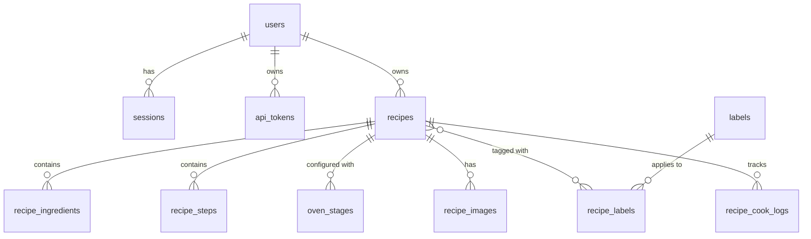

# 30 — Data Model & SQLite Schema

Owner: Architect / Go Lead. Status: authoritative for implementation.
Companion docs: `20-architecture.md`, `25-oven-settings.md`, `40-api.md`.

## 1. Storage & SQLite Configuration

- **Engine:** Pure Go SQLite (`modernc.org/sqlite`, CGO-free).
- **File location:** `/data/recipes.db`.
- **Journal mode:** `WAL` (Write-Ahead Logging).
- **Synchronous:** `NORMAL`.
- **Foreign Keys:** `PRAGMA foreign_keys = ON;` (must be executed on every opened connection).
- **Busy Timeout:** `PRAGMA busy_timeout = 5000;` (5 seconds).
- **Concurrency model:** Single write connection pool (`SetMaxOpenConns(1)`), multiple read connection pools.

## 2. Entities & Relationships Overview



### Deletion & Cascade Policy
- **Hard Delete Rule:** When a recipe is deleted, its record is deleted from SQLite.
- Foreign keys use `ON DELETE CASCADE` for:
  - `recipe_ingredients`
  - `recipe_steps`
  - `oven_stages`
  - `recipe_images` (Note: image metadata in DB is deleted via cascade; file removal on `/data/media` is triggered in the transaction commit hook in Go service layer).
  - `recipe_labels`
  - `recipe_cook_logs`
- **User Removal Policy:**
  - If a user is deleted from Authentik or the DB:
    - User's **private** recipes and inbox items are deleted (cascade).
    - User's **shared** recipes: either reassigned to an admin or marked with `owner_id = NULL` (system owner). In this spec, to maintain consistency with household use, recipes have `owner_id TEXT NULL REFERENCES users(id) ON DELETE SET NULL`. Shared recipes remain available to all household members.
    - User's sessions and API tokens are cascaded on delete.

---

## 3. SQL Migrations (goose format)

### Migration `0001_initial_schema.sql`

```sql
-- +goose Up
-- +goose StatementBegin

-- 1. Users (provisioned via Authentik OIDC)
CREATE TABLE users (
    id TEXT PRIMARY KEY,                 -- OIDC 'sub' claim (e.g., UUID or unique string from Authentik)
    email TEXT NOT NULL,
    display_name TEXT NOT NULL,
    avatar_url TEXT,
    is_admin INTEGER NOT NULL DEFAULT 0, -- 1 for admins (mapped from Authentik group 'recipes-admins')
    created_at DATETIME NOT NULL DEFAULT CURRENT_TIMESTAMP,
    updated_at DATETIME NOT NULL DEFAULT CURRENT_TIMESTAMP
);

CREATE UNIQUE INDEX idx_users_email ON users(email);

-- 2. Sessions (Cookie-based session store)
CREATE TABLE sessions (
    id TEXT PRIMARY KEY,                 -- secure 32-byte hex random token
    user_id TEXT NOT NULL REFERENCES users(id) ON DELETE CASCADE,
    created_at DATETIME NOT NULL DEFAULT CURRENT_TIMESTAMP,
    expires_at DATETIME NOT NULL,
    last_seen_at DATETIME NOT NULL DEFAULT CURRENT_TIMESTAMP,
    user_agent TEXT,
    ip_address TEXT
);

CREATE INDEX idx_sessions_user_id ON sessions(user_id);
CREATE INDEX idx_sessions_expires_at ON sessions(expires_at);

-- 3. API Tokens (for local AI assistant / headless access)
CREATE TABLE api_tokens (
    id TEXT PRIMARY KEY,                 -- UUID
    user_id TEXT NOT NULL REFERENCES users(id) ON DELETE CASCADE,
    name TEXT NOT NULL,                  -- Friendly name (e.g. "Home AI Assistant")
    token_hash TEXT NOT NULL UNIQUE,     -- SHA-256 hash of the plain token
    token_prefix TEXT NOT NULL,          -- First 8 characters for identification (e.g., nwf_live_...)
    last_used_at DATETIME,
    created_at DATETIME NOT NULL DEFAULT CURRENT_TIMESTAMP,
    expires_at DATETIME                  -- NULL for non-expiring
);

CREATE INDEX idx_api_tokens_user ON api_tokens(user_id);

-- 4. Categories & Labels
-- Starter categories are seeded: pizza, meat, poultry, fish, vegetables, baking, dessert, smoker, sides
CREATE TABLE labels (
    id INTEGER PRIMARY KEY AUTOINCREMENT,
    name TEXT NOT NULL COLLATE NOCASE,   -- Name in English or Hebrew
    slug TEXT NOT NULL UNIQUE,           -- Normalized URL slug
    type TEXT NOT NULL CHECK(type IN ('category', 'tag')), -- category (main bucket) vs tag (free label)
    icon TEXT,                           -- Lucide icon name or emoji
    created_at DATETIME NOT NULL DEFAULT CURRENT_TIMESTAMP
);

CREATE INDEX idx_labels_type ON labels(type);

-- 5. Recipes
CREATE TABLE recipes (
    id TEXT PRIMARY KEY,                 -- UUID v4
    owner_id TEXT REFERENCES users(id) ON DELETE SET NULL,
    title TEXT NOT NULL,
    description TEXT,
    source_url TEXT,                     -- Web link if imported from web
    source_name TEXT,                    -- Site name (e.g., "BBC Good Food", "Serious Eats")
    prep_time_minutes INTEGER,
    cook_time_minutes INTEGER,
    servings INTEGER,
    difficulty TEXT CHECK(difficulty IN ('easy', 'medium', 'hard', NULL)),
    visibility TEXT NOT NULL DEFAULT 'private' CHECK(visibility IN ('private', 'shared')),
    status TEXT NOT NULL DEFAULT 'active' CHECK(status IN ('inbox', 'active', 'archived')),
    language TEXT NOT NULL DEFAULT 'en' CHECK(language IN ('en', 'he')), -- for text direction detection
    notes TEXT,                          -- Private/Owner cooking notes ("Next time use less salt")
    rating INTEGER CHECK(rating BETWEEN 1 AND 5),
    created_at DATETIME NOT NULL DEFAULT CURRENT_TIMESTAMP,
    updated_at DATETIME NOT NULL DEFAULT CURRENT_TIMESTAMP
);

CREATE INDEX idx_recipes_owner_status ON recipes(owner_id, status);
CREATE INDEX idx_recipes_visibility ON recipes(visibility) WHERE status = 'active';
CREATE INDEX idx_recipes_updated_at ON recipes(updated_at DESC);

-- 6. Recipe Ingredients
CREATE TABLE recipe_ingredients (
    id INTEGER PRIMARY KEY AUTOINCREMENT,
    recipe_id TEXT NOT NULL REFERENCES recipes(id) ON DELETE CASCADE,
    position INTEGER NOT NULL,
    item TEXT NOT NULL,                  -- e.g. "Chicken thighs, skin-on"
    amount REAL,                         -- e.g. 500
    unit TEXT,                           -- Metric only: 'g', 'kg', 'ml', 'l', 'tbsp', 'tsp', 'unit', 'pinch'
    note TEXT                            -- e.g. "room temperature"
);

CREATE INDEX idx_recipe_ingredients_recipe ON recipe_ingredients(recipe_id, position);

-- 7. Recipe Steps (Instructions)
CREATE TABLE recipe_steps (
    id INTEGER PRIMARY KEY AUTOINCREMENT,
    recipe_id TEXT NOT NULL REFERENCES recipes(id) ON DELETE CASCADE,
    position INTEGER NOT NULL,
    instruction TEXT NOT NULL,           -- Markdown or plain text
    title TEXT                           -- Optional step header (e.g., "Prep Rub", "Preheat Oven")
);

CREATE INDEX idx_recipe_steps_recipe ON recipe_steps(recipe_id, position);

-- 8. Ninja Woodfire Oven Stages (Detailed in 25-oven-settings.md)
CREATE TABLE oven_stages (
    id INTEGER PRIMARY KEY AUTOINCREMENT,
    recipe_id TEXT NOT NULL REFERENCES recipes(id) ON DELETE CASCADE,
    position INTEGER NOT NULL,           -- Stage order: 1, 2, ...
    mode TEXT NOT NULL CHECK(mode IN (
        'pizza', 'max_roast', 'specialty_roast', 'top_heat', 
        'bake', 'smoker', 'dehydrate', 'keep_warm'
    )),
    pizza_preset TEXT CHECK(pizza_preset IN (
        'artisan', 'thin', 'pan', 'new_york', 'frozen', 'custom', NULL
    )),
    temperature_c INTEGER,               -- Range validated in application code per mode (40-370°C)
    top_heat_level TEXT CHECK(top_heat_level IN ('hi', 'lo', NULL)),
    duration_seconds INTEGER,            -- Stored in seconds; 0 or NULL for manual stop
    woodfire INTEGER NOT NULL DEFAULT 0 CHECK(woodfire IN (0, 1)), -- Pellet smoke enabled?
    pellet_blend TEXT CHECK(pellet_blend IN ('all_purpose', 'robust', 'other', NULL)),
    pellet_scoops INTEGER CHECK(pellet_scoops BETWEEN 1 AND 3),
    accessory TEXT CHECK(accessory IN (
        'pizza_stone', 'pro_heat_pan', 'roast_rack', 'accessory_frame', NULL
    )),
    frame_level TEXT CHECK(frame_level IN ('low', 'high', NULL)),
    target_internal_temp_c INTEGER       -- Optional meat probe target temp
);

CREATE INDEX idx_oven_stages_recipe ON oven_stages(recipe_id, position);

-- 9. Recipe Images
CREATE TABLE recipe_images (
    id TEXT PRIMARY KEY,                 -- UUID v4
    recipe_id TEXT NOT NULL REFERENCES recipes(id) ON DELETE CASCADE,
    position INTEGER NOT NULL DEFAULT 0, -- 0 is the primary cover image
    file_path TEXT NOT NULL,             -- Relative path inside /data/media/ (e.g. 2026/10/uuid.jpg)
    thumb_path TEXT NOT NULL,            -- Relative path to thumbnail (e.g. 2026/10/uuid_thumb.jpg)
    file_size_bytes INTEGER NOT NULL,
    width INTEGER NOT NULL,
    height INTEGER NOT NULL,
    mime_type TEXT NOT NULL DEFAULT 'image/jpeg',
    created_at DATETIME NOT NULL DEFAULT CURRENT_TIMESTAMP
);

CREATE INDEX idx_recipe_images_recipe ON recipe_images(recipe_id, position);

-- 10. Recipe <-> Label Join Table
CREATE TABLE recipe_labels (
    recipe_id TEXT NOT NULL REFERENCES recipes(id) ON DELETE CASCADE,
    label_id INTEGER NOT NULL REFERENCES labels(id) ON DELETE CASCADE,
    PRIMARY KEY (recipe_id, label_id)
);

CREATE INDEX idx_recipe_labels_label ON recipe_labels(label_id);

-- 11. Cook History Log ("Cooked it")
CREATE TABLE recipe_cook_logs (
    id INTEGER PRIMARY KEY AUTOINCREMENT,
    recipe_id TEXT NOT NULL REFERENCES recipes(id) ON DELETE CASCADE,
    user_id TEXT NOT NULL REFERENCES users(id) ON DELETE CASCADE,
    cooked_at DATETIME NOT NULL DEFAULT CURRENT_TIMESTAMP,
    notes TEXT,                          -- Post-cook observations
    rating INTEGER CHECK(rating BETWEEN 1 AND 5)
);

CREATE INDEX idx_recipe_cook_logs_recipe ON recipe_cook_logs(recipe_id, cooked_at DESC);

-- 12. SQLite FTS5 Full-Text Search Table
CREATE VIRTUAL TABLE recipes_fts USING fts5(
    recipe_id UNINDEXED,
    title,
    description,
    ingredients,
    steps,
    notes,
    tokenize = 'trigram'                -- Trigram supports English and Hebrew substring matching
);

-- Triggers to maintain FTS index synchronized with recipes, ingredients, steps
-- Note: Application code triggers an async/sync rebuild or updates on transaction commit
-- to cleanly concatenate child rows (ingredients, steps).

-- +goose StatementEnd

-- +goose Down
-- +goose StatementBegin
DROP TABLE IF EXISTS recipes_fts;
DROP TABLE IF EXISTS recipe_cook_logs;
DROP TABLE IF EXISTS recipe_labels;
DROP TABLE IF EXISTS recipe_images;
DROP TABLE IF EXISTS oven_stages;
DROP TABLE IF EXISTS recipe_steps;
DROP TABLE IF EXISTS recipe_ingredients;
DROP TABLE IF EXISTS recipes;
DROP TABLE IF EXISTS labels;
DROP TABLE IF EXISTS api_tokens;
DROP TABLE IF EXISTS sessions;
DROP TABLE IF EXISTS users;
-- +goose StatementEnd
```

---

## 4. Starter Data Seeding (Migration `0002_seed_starter_labels.sql`)

```sql
-- +goose Up
-- +goose StatementBegin
INSERT INTO labels (name, slug, type, icon) VALUES
('Pizza', 'pizza', 'category', 'pizza'),
('Meat', 'meat', 'category', 'beef'),
('Poultry & Chicken', 'chicken', 'category', 'drumstick'),
('Fish & Seafood', 'fish', 'category', 'fish'),
('Vegetables', 'vegetables', 'category', 'carrot'),
('Baking & Bread', 'baking', 'category', 'croissant'),
('Dessert', 'dessert', 'category', 'cake'),
('Smoked', 'smoked', 'category', 'flame'),
('Sides', 'sides', 'category', 'salad'),
-- Common tags
('Woodfire Flavor', 'woodfire-flavor', 'tag', 'sparkles'),
('Quick & Easy', 'quick-easy', 'tag', 'clock'),
('Weekend Cook', 'weekend', 'tag', 'calendar');
-- +goose StatementEnd

-- +goose Down
-- +goose StatementBegin
DELETE FROM labels;
-- +goose StatementEnd
```

---

## 5. FTS Synchronization Strategy

Because ingredients and steps are in normalized 1:N relational tables, standard row triggers on `recipes` alone would miss ingredient edits.
The application service layer maintains `recipes_fts` within the transaction that modifies a recipe:

```sql
-- On Recipe Insert/Update:
DELETE FROM recipes_fts WHERE recipe_id = :recipe_id;

INSERT INTO recipes_fts(recipe_id, title, description, ingredients, steps, notes)
VALUES (
    :recipe_id,
    :title,
    :description,
    (SELECT COALESCE(GROUP_CONCAT(item, ' '), '') FROM recipe_ingredients WHERE recipe_id = :recipe_id),
    (SELECT COALESCE(GROUP_CONCAT(instruction, ' '), '') FROM recipe_steps WHERE recipe_id = :recipe_id),
    :notes
);
```

When querying:
```sql
SELECT r.* FROM recipes r
JOIN recipes_fts fts ON r.id = fts.recipe_id
WHERE recipes_fts MATCH :query
AND (r.visibility = 'shared' OR r.owner_id = :current_user_id)
AND r.status = 'active';
```
Trigram tokenization allows matching word stems and substrings for both Latin and Hebrew scripts seamlessly.
