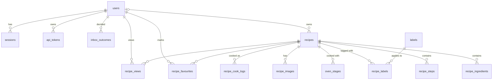

# 30 — Data Model & SQLite Schema

Owner: Architect. Status: **canonical** for every table, column, constraint, index and seed row.
Other documents refer to this one and must not restate the schema. Behaviour that *uses* the schema
(authz, search, events) is canonical in `20-architecture.md`; oven-field semantics in `25-oven-settings.md`.

## 1. Storage conventions

- Engine, pragmas, pools: see `20-architecture.md §14`. Database file: `${APP_DATA_DIR}/recipes.db`.
- **Timestamps** are stored as `TEXT` in RFC 3339 UTC with millisecond precision (`2026-10-27T13:30:00.000Z`),
  written by Go (`time.Now().UTC().Format("2006-01-02T15:04:05.000Z07:00")`). Column defaults use
  `strftime('%Y-%m-%dT%H:%M:%fZ','now')` so ad-hoc inserts produce the same format. Lexical order = time order.
- **Public IDs** (`users.id`, `recipes.id`, `api_tokens.id`, `recipe_images.id`) are UUID v4 strings.
  Child rows that are never addressed individually use `INTEGER PRIMARY KEY`.
- Booleans are `INTEGER` `0/1` with a `CHECK`.
- `updated_at` is set by the service layer on every write (no triggers).
- Migrations: goose v3, embedded, table `goose_db_version`. **Until the first production deployment, `0001`
  and `0002` may be edited in place; afterwards migrations are forward-only and append-only.**
  On startup, if the DB version is higher than the newest embedded migration, the binary refuses to start
  (explicit check; goose does not do this by itself). See `20-architecture.md §14`.

## 2. Entity overview



## 3. Lifecycle and deletion rules

| Event | Effect (all in one write transaction; image files removed after commit, see `20 §9`) |
|---|---|
| Recipe deleted (hard) | Row deleted; FK `ON DELETE CASCADE` removes ingredients, steps, stages, images rows, labels links, cook logs, favourites, views; FTS row deleted by the service. |
| Inbox item kept | `status='active'`; an `inbox_outcomes` row (`kept`, `edited`, `shared`) is written in the same transaction (§5a). |
| Inbox item rejected | Same as recipe deleted, plus an `inbox_outcomes` row (`rejected`, optional `reason`/`note`) in the same transaction (§5a). |
| Cook-log entry deleted | Its photo (`recipe_images` row with `kind='cook_log'`) and files are deleted too. |
| Recipe **unshared** (`shared → private`) | All `recipe_favourites` and `recipe_views` rows of users **other than the owner** for that recipe are deleted. Cook logs are kept (they become visible to the owner only, since only the owner can view the recipe). |
| User deleted (`recipes user delete <id>` CLI only; there is no automatic deletion) | Service procedure, in order: (1) hard-delete every recipe the user owns that is `private` or `status='inbox'` (including images); (2) set `owner_id = NULL` on their `shared` recipes; (3) delete the user row (cascades sessions, tokens, cook logs, favourites, views). The FK `ON DELETE SET NULL` on `recipes.owner_id` is a safety net only. |
| User disabled in Authentik | Nothing in the DB. New logins fail; existing sessions remain until expiry or `recipes user revoke-sessions`. |

Ownerless shared recipes (`owner_id IS NULL`) stay shared and editable by everyone; they can no longer be unshared
(see authz in `20 §7`).

## 4. Migration `0001_initial_schema.sql`

```sql
-- +goose Up
-- +goose StatementBegin

CREATE TABLE users (
    id            TEXT PRIMARY KEY,                       -- UUID v4 (internal; never the OIDC sub)
    oidc_issuer   TEXT NOT NULL,
    oidc_subject  TEXT NOT NULL,
    email         TEXT NOT NULL DEFAULT '',               -- informational, refreshed each login, NOT unique
    display_name  TEXT NOT NULL,
    is_admin      INTEGER NOT NULL DEFAULT 0 CHECK (is_admin IN (0,1)),
    ui_language   TEXT CHECK (ui_language IN ('en','he')), -- NULL = not chosen yet
    last_login_at TEXT,
    created_at    TEXT NOT NULL DEFAULT (strftime('%Y-%m-%dT%H:%M:%fZ','now')),
    updated_at    TEXT NOT NULL DEFAULT (strftime('%Y-%m-%dT%H:%M:%fZ','now')),
    UNIQUE (oidc_issuer, oidc_subject)
);

CREATE TABLE oidc_login_states (
    state      TEXT PRIMARY KEY,
    verifier   TEXT NOT NULL,
    nonce      TEXT NOT NULL,
    return_to  TEXT NOT NULL DEFAULT '/',
    expires_at TEXT NOT NULL
);
CREATE INDEX idx_oidc_login_states_expires ON oidc_login_states(expires_at);

CREATE TABLE sessions (
    id_hash      TEXT PRIMARY KEY,                        -- hex SHA-256 of the cookie token; raw token never stored
    user_id      TEXT NOT NULL REFERENCES users(id) ON DELETE CASCADE,
    id_token     TEXT,                                    -- for end-session id_token_hint
    user_agent   TEXT,
    ip_address   TEXT,
    created_at   TEXT NOT NULL DEFAULT (strftime('%Y-%m-%dT%H:%M:%fZ','now')),
    last_seen_at TEXT NOT NULL DEFAULT (strftime('%Y-%m-%dT%H:%M:%fZ','now')),
    expires_at   TEXT NOT NULL
);
CREATE INDEX idx_sessions_user    ON sessions(user_id);
CREATE INDEX idx_sessions_expires ON sessions(expires_at);

CREATE TABLE api_tokens (
    id           TEXT PRIMARY KEY,
    user_id      TEXT NOT NULL REFERENCES users(id) ON DELETE CASCADE,
    name         TEXT NOT NULL,
    token_hash   TEXT NOT NULL UNIQUE,                    -- hex SHA-256 of the full token string
    token_prefix TEXT NOT NULL,                           -- first 8 chars after 'nwr_', for display
    scopes       TEXT NOT NULL DEFAULT 'inbox:write recipes:read', -- space-separated
    last_used_at TEXT,
    expires_at   TEXT,                                    -- NULL = never
    revoked_at   TEXT,
    created_at   TEXT NOT NULL DEFAULT (strftime('%Y-%m-%dT%H:%M:%fZ','now'))
);
CREATE INDEX idx_api_tokens_user ON api_tokens(user_id);

-- Categories (fixed, translated, admin-managed) and tags (free, user-created) share one table.
CREATE TABLE labels (
    id         INTEGER PRIMARY KEY,
    type       TEXT NOT NULL CHECK (type IN ('category','tag')),
    slug       TEXT NOT NULL,                             -- category: stable key, e.g. 'poultry'; tag: normalized name
    name       TEXT NOT NULL,                             -- category: English name; tag: the tag as typed (normalized)
    name_he    TEXT,                                      -- category: Hebrew name (required for categories); tag: NULL
    icon       TEXT,                                      -- category: emoji shown on the home tile; tag: NULL
    sort_order INTEGER NOT NULL DEFAULT 0,                -- category tile order
    created_by TEXT REFERENCES users(id) ON DELETE SET NULL,
    created_at TEXT NOT NULL DEFAULT (strftime('%Y-%m-%dT%H:%M:%fZ','now')),
    UNIQUE (type, slug),
    CHECK (type = 'tag' OR name_he IS NOT NULL)
);

CREATE TABLE recipes (
    id                TEXT PRIMARY KEY,
    owner_id          TEXT REFERENCES users(id) ON DELETE SET NULL,
    status            TEXT NOT NULL DEFAULT 'active' CHECK (status IN ('inbox','active')),
    visibility        TEXT NOT NULL DEFAULT 'private' CHECK (visibility IN ('private','shared')),
    title             TEXT NOT NULL,
    description       TEXT NOT NULL DEFAULT '',
    notes             TEXT NOT NULL DEFAULT '',           -- standing tips on the recipe itself (editable like any field)
    language          TEXT NOT NULL DEFAULT 'und' CHECK (language IN ('en','he','und')),
    servings          INTEGER CHECK (servings BETWEEN 1 AND 100),
    prep_minutes      INTEGER CHECK (prep_minutes >= 0),
    source_url        TEXT,
    source_name       TEXT,
    import_key        TEXT,                               -- API idempotency key (see 40 §4.2)
    version           INTEGER NOT NULL DEFAULT 1,         -- optimistic concurrency; +1 on every update
    categorized_at    TEXT,                               -- future LLM hook: NULL = not yet processed (20 §15)
    created_by        TEXT REFERENCES users(id) ON DELETE SET NULL,
    updated_by        TEXT REFERENCES users(id) ON DELETE SET NULL,
    created_at        TEXT NOT NULL DEFAULT (strftime('%Y-%m-%dT%H:%M:%fZ','now')),
    updated_at        TEXT NOT NULL DEFAULT (strftime('%Y-%m-%dT%H:%M:%fZ','now')),
    CHECK (status = 'active' OR visibility = 'private')   -- inbox items are always private
);
CREATE INDEX idx_recipes_owner_status ON recipes(owner_id, status);
CREATE INDEX idx_recipes_shared       ON recipes(updated_at DESC) WHERE status = 'active' AND visibility = 'shared';
CREATE INDEX idx_recipes_updated      ON recipes(updated_at DESC);
CREATE UNIQUE INDEX idx_recipes_import_key ON recipes(owner_id, import_key) WHERE import_key IS NOT NULL;
CREATE INDEX idx_recipes_source_url   ON recipes(owner_id, source_url) WHERE source_url IS NOT NULL;

CREATE TABLE recipe_ingredients (
    id        INTEGER PRIMARY KEY,
    recipe_id TEXT NOT NULL REFERENCES recipes(id) ON DELETE CASCADE,
    position  INTEGER NOT NULL,                           -- 1..n, contiguous, set by the service from input order
    section   TEXT,                                       -- optional group header, e.g. "Dough", "Topping"
    amount    REAL CHECK (amount > 0),                    -- NULL = unquantified ("salt to taste")
    unit      TEXT CHECK (unit IN ('g','kg','ml','l','tsp','tbsp','pcs','pinch')),
    item      TEXT NOT NULL,                              -- e.g. "chicken thighs, skin-on"
    raw_text  TEXT NOT NULL,                              -- the line as the user typed/pasted it (shown if parsing failed)
    UNIQUE (recipe_id, position)
);

CREATE TABLE recipe_steps (
    id            INTEGER PRIMARY KEY,
    recipe_id     TEXT NOT NULL REFERENCES recipes(id) ON DELETE CASCADE,
    position      INTEGER NOT NULL,
    text          TEXT NOT NULL,                          -- plain text; no Markdown in v1
    timer_seconds INTEGER CHECK (timer_seconds BETWEEN 1 AND 86400), -- optional tap-to-start timer (C3)
    UNIQUE (recipe_id, position)
);

-- Field semantics and validation: 25-oven-settings.md §2–§4.
CREATE TABLE oven_stages (
    id                 INTEGER PRIMARY KEY,
    recipe_id          TEXT NOT NULL REFERENCES recipes(id) ON DELETE CASCADE,
    position           INTEGER NOT NULL,
    mode               TEXT NOT NULL CHECK (mode IN ('pizza','gourmet_roast','max_roast','smoker','bake','broil','dehydrate','keep_warm')),
    pizza_preset       TEXT CHECK (pizza_preset IN ('artisan','thin_crust','new_york','chicago','calzone','custom')),
    temperature_c      INTEGER CHECK (temperature_c BETWEEN 20 AND 400),  -- coarse DB guard; real limits in 25 §4. Gourmet Roast: Stage 1
    duration_seconds   INTEGER CHECK (duration_seconds >= 0),             -- Gourmet Roast: Stage 1
    temperature2_c     INTEGER CHECK (temperature2_c BETWEEN 20 AND 400), -- Gourmet Roast Stage 2 only
    duration2_seconds  INTEGER CHECK (duration2_seconds >= 0),            -- Gourmet Roast Stage 2 only
    preheat_minutes    INTEGER CHECK (preheat_minutes BETWEEN 0 AND 120),
    woodfire           INTEGER NOT NULL DEFAULT 0 CHECK (woodfire IN (0,1)),
    pellet_blend       TEXT CHECK (pellet_blend IN ('all_purpose','robust','other')),
    pellet_note        TEXT,                              -- e.g. "cherry", "hickory"
    accessories        TEXT NOT NULL DEFAULT '[]',        -- JSON array of Accessory keys (pizza_stone, pro_heat_pan, roast_rack, own_pan), sorted, unique
    target_core_temp_c INTEGER CHECK (target_core_temp_c BETWEEN 30 AND 100),
    notes              TEXT NOT NULL DEFAULT '',
    UNIQUE (recipe_id, position)
);

CREATE TABLE recipe_images (
    id          TEXT PRIMARY KEY,
    recipe_id   TEXT NOT NULL REFERENCES recipes(id) ON DELETE CASCADE,
    storage_key TEXT NOT NULL UNIQUE,                     -- 32 hex chars; file layout in 20 §9
    kind        TEXT NOT NULL DEFAULT 'recipe' CHECK (kind IN ('recipe','cook_log')), -- cook_log photos are not in the gallery
    position    INTEGER,                                  -- recipe photos: 1 = cover; cook_log photos: NULL
    width       INTEGER NOT NULL,                         -- of the 'full' variant
    height      INTEGER NOT NULL,
    bytes       INTEGER NOT NULL,                         -- full + thumb on disk
    caption     TEXT,
    source_url  TEXT,                                     -- when fetched by the API
    created_at  TEXT NOT NULL DEFAULT (strftime('%Y-%m-%dT%H:%M:%fZ','now')),
    UNIQUE (recipe_id, position),
    CHECK ((kind = 'recipe') = (position IS NOT NULL))
);

CREATE TABLE recipe_labels (
    recipe_id TEXT NOT NULL REFERENCES recipes(id) ON DELETE CASCADE,
    label_id  INTEGER NOT NULL REFERENCES labels(id) ON DELETE CASCADE,
    source    TEXT NOT NULL DEFAULT 'user' CHECK (source IN ('user','assistant','llm')),
    PRIMARY KEY (recipe_id, label_id)
);
CREATE INDEX idx_recipe_labels_label ON recipe_labels(label_id);

CREATE TABLE recipe_cook_logs (
    id        INTEGER PRIMARY KEY,
    recipe_id TEXT NOT NULL REFERENCES recipes(id) ON DELETE CASCADE,
    user_id   TEXT NOT NULL REFERENCES users(id) ON DELETE CASCADE,
    cooked_at TEXT NOT NULL DEFAULT (strftime('%Y-%m-%dT%H:%M:%fZ','now')),
    note      TEXT NOT NULL DEFAULT '',
    rating    INTEGER CHECK (rating BETWEEN 1 AND 5),
    image_id  TEXT UNIQUE REFERENCES recipe_images(id) ON DELETE SET NULL  -- optional photo (kind = 'cook_log')
);
CREATE INDEX idx_cook_logs_recipe ON recipe_cook_logs(recipe_id, cooked_at DESC);
CREATE INDEX idx_cook_logs_user   ON recipe_cook_logs(user_id, cooked_at DESC);

CREATE TABLE recipe_favourites (
    user_id    TEXT NOT NULL REFERENCES users(id) ON DELETE CASCADE,
    recipe_id  TEXT NOT NULL REFERENCES recipes(id) ON DELETE CASCADE,
    created_at TEXT NOT NULL DEFAULT (strftime('%Y-%m-%dT%H:%M:%fZ','now')),
    PRIMARY KEY (user_id, recipe_id)
);

-- One row per (user, recipe): last time the user opened the recipe page or cook mode (B3).
CREATE TABLE recipe_views (
    user_id   TEXT NOT NULL REFERENCES users(id) ON DELETE CASCADE,
    recipe_id TEXT NOT NULL REFERENCES recipes(id) ON DELETE CASCADE,
    viewed_at TEXT NOT NULL,
    PRIMARY KEY (user_id, recipe_id)
);
CREATE INDEX idx_recipe_views_user ON recipe_views(user_id, viewed_at DESC);

-- Full-text index; maintained by the service layer (20 §11). One row per ACTIVE recipe.
CREATE VIRTUAL TABLE recipe_fts USING fts5(
    recipe_id UNINDEXED,
    title,
    description,
    ingredients,
    steps,
    labels,        -- category names (EN + HE) and tag names
    notes,         -- recipes.notes + all cook-log notes
    tokenize = 'trigram remove_diacritics 1'
);

-- +goose StatementEnd

-- +goose Down
-- +goose StatementBegin
DROP TABLE IF EXISTS recipe_fts;
DROP TABLE IF EXISTS recipe_views;
DROP TABLE IF EXISTS recipe_favourites;
DROP TABLE IF EXISTS recipe_cook_logs;
DROP TABLE IF EXISTS recipe_labels;
DROP TABLE IF EXISTS recipe_images;
DROP TABLE IF EXISTS oven_stages;
DROP TABLE IF EXISTS recipe_steps;
DROP TABLE IF EXISTS recipe_ingredients;
DROP TABLE IF EXISTS recipes;
DROP TABLE IF EXISTS labels;
DROP TABLE IF EXISTS api_tokens;
DROP TABLE IF EXISTS sessions;
DROP TABLE IF EXISTS oidc_login_states;
DROP TABLE IF EXISTS users;
-- +goose StatementEnd
```

Notes:
- `recipe_fts.recipe_id` is `UNINDEXED`, so `DELETE FROM recipe_fts WHERE recipe_id = ?` scans the FTS table.
  That is acceptable at the stated scale (< 10k recipes). Do **not** map FTS `rowid` to the implicit rowid of
  `recipes`: a table without an `INTEGER PRIMARY KEY` may have its rowids renumbered by `VACUUM`/`VACUUM INTO`,
  which would corrupt the mapping in restored backups.
- Inbox items are **not** in `recipe_fts`; the row is inserted when an item is accepted.
- There is deliberately no `recipes.rating` column: ratings live only in `recipe_cook_logs` (see §6).

## 5. Migration `0002_seed_categories.sql`

Categories are seeded with stable slugs. Admins can add, rename (both languages), reorder or delete categories
later from `/admin/categories` (`40 §2`). Deleting a category removes its links (cascade); recipes are not deleted.

```sql
-- +goose Up
INSERT INTO labels (type, slug, name, name_he, icon, sort_order) VALUES
('category','pizza',        'Pizza',             'פיצה',             '🍕', 10),
('category','bread_dough',  'Bread & Dough',     'לחם ובצקים',       '🍞', 20),
('category','beef',         'Beef',              'בקר',              '🥩', 30),
('category','lamb',         'Lamb',              'טלה',              '🍖', 40),
('category','pork',         'Pork',              'חזיר',             '🥓', 50),
('category','poultry',      'Chicken & Poultry', 'עוף',              '🍗', 60),
('category','fish_seafood', 'Fish & Seafood',    'דגים ופירות ים',   '🐟', 70),
('category','vegetables',   'Vegetables',        'ירקות',            '🥦', 80),
('category','sides',        'Sides',             'תוספות',           '🥔', 90),
('category','desserts',     'Desserts',          'קינוחים',          '🍰', 100),
('category','snacks_dried', 'Snacks & Dried',    'חטיפים ומיובשים',  '🥨', 110),
('category','other',        'Other',             'אחר',              '🍽️', 120);

-- +goose Down
DELETE FROM labels WHERE type = 'category' AND created_by IS NULL;
```

"Smoked" is not a category: it is derived from the stages (any stage `smoker` or `woodfire = 1`) and appears on the
home screen as a virtual tile (see `70 §4.1`). Hebrew names are suggestions for native review.

## 5a. Migration `0003_assistant_feedback.sql`

Supports the assistant feedback loop (decisions 4.13–4.15): duplicate detection on a normalized source URL, a durable
record of every Keep / Throw away decision, and the per-user "what to look for" text. Written as a new migration so it
applies whether or not `0001`/`0002` have reached production.

```sql
-- +goose Up
-- +goose StatementBegin
ALTER TABLE recipes ADD COLUMN source_key TEXT;          -- normalized source_url (40 §4.3); set by the service on every write
DROP INDEX idx_recipes_source_url;
CREATE INDEX idx_recipes_source_key ON recipes(owner_id, source_key) WHERE source_key IS NOT NULL;

ALTER TABLE users ADD COLUMN assistant_brief TEXT NOT NULL DEFAULT '';  -- "What should your assistant look for?" (40 §8)
ALTER TABLE users ADD COLUMN assistant_brief_updated_at TEXT;

-- One row per Keep / Throw away decision on an inbox item. The row outlives the hard delete of a thrown-away item,
-- so the same recipe is not offered again (40 §4 rule 3), and it is the feed behind GET /api/v1/inbox/outcomes (40 §7).
CREATE TABLE inbox_outcomes (
    id         INTEGER PRIMARY KEY,                       -- monotonic; the API cursor
    user_id    TEXT NOT NULL REFERENCES users(id) ON DELETE CASCADE,
    item_id    TEXT NOT NULL,                             -- the item's recipes.id; no FK (a thrown-away item is gone)
    title      TEXT NOT NULL,                             -- at decision time (after edits, for "Edit, then keep")
    source_url TEXT,                                      -- as the assistant submitted it (before any edit while keeping)
    source_key TEXT,                                      -- normalized source_url
    outcome    TEXT NOT NULL CHECK (outcome IN ('kept','rejected')),
    reason     TEXT CHECK (reason IN ('not_our_taste','too_complicated','not_for_our_oven','already_have','poor_details')),
    note       TEXT NOT NULL DEFAULT '',                  -- optional, ≤ 200
    edited     INTEGER NOT NULL DEFAULT 0 CHECK (edited IN (0,1)),   -- kept via "Edit, then keep"
    shared     INTEGER NOT NULL DEFAULT 0 CHECK (shared IN (0,1)),   -- kept with "Share with family too"
    decided_at TEXT NOT NULL DEFAULT (strftime('%Y-%m-%dT%H:%M:%fZ','now')),
    CHECK (outcome = 'rejected' OR (reason IS NULL AND note = '')),
    CHECK (outcome = 'kept' OR (edited = 0 AND shared = 0))
);
CREATE INDEX idx_inbox_outcomes_user   ON inbox_outcomes(user_id, id);
CREATE INDEX idx_inbox_outcomes_source ON inbox_outcomes(user_id, source_key) WHERE source_key IS NOT NULL;
-- +goose StatementEnd

-- +goose Down
-- +goose StatementBegin
DROP TABLE IF EXISTS inbox_outcomes;
ALTER TABLE users DROP COLUMN assistant_brief_updated_at;
ALTER TABLE users DROP COLUMN assistant_brief;
DROP INDEX IF EXISTS idx_recipes_source_key;
ALTER TABLE recipes DROP COLUMN source_key;
CREATE INDEX idx_recipes_source_url ON recipes(owner_id, source_url) WHERE source_url IS NOT NULL;
-- +goose StatementEnd
```

Notes:
- `source_key` cannot be computed in SQL. The store sets it on every insert and update of a recipe. After migrations and
  before the listener opens, startup sets it for every row with `source_url IS NOT NULL AND source_key IS NULL` (one write
  transaction; a no-op once done; rows whose URL is not an absolute http(s) URL stay `NULL`).
- When an item is kept with "Edit, then keep" and the user changed its source URL, the outcome still records the URL the
  assistant submitted, so resubmitting the original is refused; the recipe itself guards the edited URL (40 §4 rule 2).
- Outcome rows are never edited or pruned. They are deleted only with their user. Withdrawing an item through the API
  (`DELETE /api/v1/inbox/{id}`) writes no outcome: the assistant already knows.
- Keeping an item and later deleting the recipe leaves its `kept` row, so the recipe is not offered again.

## 6. Derived values (computed in queries, not stored)

| Value | Definition |
|---|---|
| Primary mode | `25 §5` |
| Total oven time | `SUM(COALESCE(duration_seconds,0) + COALESCE(duration2_seconds,0))` over stages (preheat excluded) |
| Uses woodfire | `EXISTS` stage with `woodfire = 1` |
| Cook count / last cooked | `COUNT(*)`, `MAX(cooked_at)` from `recipe_cook_logs` **visible to the viewer** (all logs for shared recipes; for private recipes only the owner can view the recipe at all) |
| Average rating | `AVG(rating)` over the same logs, ignoring NULL; shown with one decimal and the count |
| Recently cooked/viewed (per user) | Union of the user's `recipe_views.viewed_at` and own `recipe_cook_logs.cooked_at`, max per recipe, restricted to recipes the user can view, newest first, limit 10 |
| "Last changed by" | `updated_at` + `users.display_name` of `updated_by` (shown only when `updated_by` ≠ viewer or differs from creator) |

## 7. Label rules

- Category slugs: `^[a-z0-9_]{2,40}$`. Category names: 1–40 chars per language.
- Tags: on input, trim, collapse whitespace, NFKC, lower-case (Latin only; Hebrew has no case), length 1–40.
  `slug = name` after normalization. Tags are created on first use by any user; there is no tag management UI in v1.
- A tag with no remaining `recipe_labels` rows is deleted by the hourly maintenance job.
- Limits per recipe: ≤ 5 categories, ≤ 20 tags (`20 §8`).
