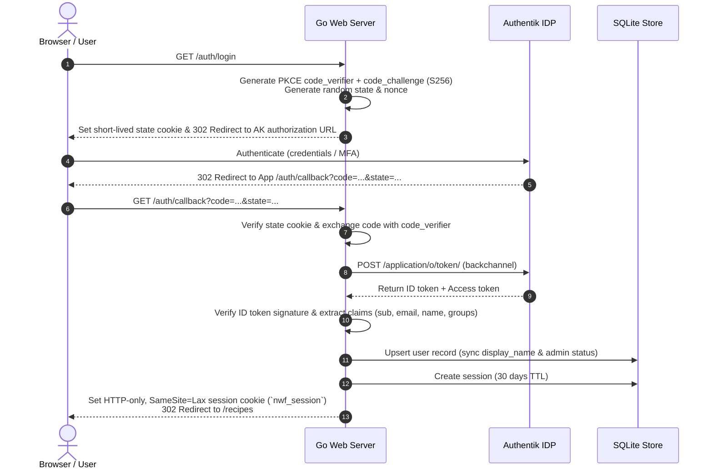

# 60 — Golang Backend Specification

Owner: Golang Lead Developer. Status: authoritative for implementation.
Companion docs: `20-architecture.md`, `25-oven-settings.md`, `30-data-model.md`, `40-api.md`.

## 1. Toolchain & Dependencies

- **Go Version:** Go 1.25+ (`go.mod` specifying `go 1.25.0`)
- **CGO Policy:** Strict `CGO_ENABLED=0` (Static Linux binary, distroless execution)
- **Key Modules:**
  - `modernc.org/sqlite v1.34.0+`: Pure Go SQLite driver
  - `github.com/pressly/goose/v3 v3.24.0+`: Database migrations
  - `github.com/coreos/go-oidc/v3 v3.11.0+`: OpenID Connect verification
  - `golang.org/x/oauth2 v0.24.0+`: OAuth 2.0 Auth Code & PKCE flow
  - `github.com/nicksnyder/go-i18n/v2 v2.4.0+`: Internationalization (EN + HE)
  - `golang.org/x/image v0.23.0+`: WebP decoding and CatmullRom high-quality resizing
  - `github.com/jdeng/goheif v0.0.0-2021072784747-702e74a24661`: Pure Go HEIC/HEIF photo decoder (Samsung Galaxy camera support)
  - `github.com/rwcarlsen/goexif/exif`: EXIF orientation parsing
  - `golang.org/x/crypto v0.31.0+`: Secure random bytes and SHA-256 helpers
  - Standard Library `log/slog`: Structured logging to stdout

---

## 2. Project Architecture & Package Responsibilities

```
cmd/recipes/
  main.go                 # CLI entry point (commands: serve, migrate, version)
internal/
  config/                 # Strongly typed config loaded from os.Environ
  domain/                 # Plain domain structs and enums
  db/                     # DB pool initialization, PRAGMA setup, goose runner
    migrations/           # *.sql embedded files
  store/                  # Repository implementations (recipes, users, stages, tokens, etc.)
  oven/                   # OO101 validation logic, preset rules, bounds checking
  auth/                   # Authentik OIDC flow, Session store, Bearer token auth, middleware
  images/                 # Pipeline: decode, EXIF orientation fix, CatmullRom resize, strip metadata
  events/                 # Light in-process publish/subscribe (e.g. recipe_created, recipe_updated)
  categorize/             # Extension hook interface (NoopCategorizer, LLMCategorizer)
  i18n/                   # Localizer middleware, active catalog loader
  httpx/                  # Middleware: recovery, request ID, slog logging, security headers
  web/                    # HTML template rendering, form decoders, htmx fragment handlers
  api/                    # JSON REST API handlers (/api/v1/inbox, etc.)
web/
  embed.go                # //go:embed templates static
  templates/              # HTML layout and partials
  static/                 # CSS, client-side JS, icons
locales/
  en.toml                 # English translation strings
  he.toml                 # Hebrew translation strings
```

---

## 3. Database Layer & Transaction Patterns

### SQLite Concurrency Model
Due to SQLite's write serialization in WAL mode, the application sets up two distinct `*sql.DB` handles or a wrapped abstraction:
1. **Writer DB (`db.Writer`):** `SetMaxOpenConns(1)` - Prevents `SQLITE_BUSY` contention during write transactions.
2. **Reader DB (`db.Reader`):** `SetMaxOpenConns(max(4, runtime.NumCPU()))` - Enables concurrent reads in WAL mode without blocking the writer.

### PRAGMAs Executed on Every Connection Open:
```sql
PRAGMA journal_mode = WAL;
PRAGMA synchronous = NORMAL;
PRAGMA foreign_keys = ON;
PRAGMA busy_timeout = 5000;
```

### Store Interface Pattern
```go
package store

type RecipeRepository interface {
    Create(ctx context.Context, r *domain.Recipe) error
    GetByID(ctx context.Context, id string) (*domain.Recipe, error)
    Update(ctx context.Context, r *domain.Recipe) error
    Delete(ctx context.Context, id string) error
    ListActive(ctx context.Context, filter domain.RecipeFilter) ([]domain.RecipeSummary, error)
    CountInbox(ctx context.Context, userID string) (int, error)
}
```

---

## 4. OIDC & Authentication Flow (Authentik Integration)



### Session Middleware:
- Injected on all browser routes.
- Resolves `nwf_session` cookie against `sessions` table.
- Sliding expiration: if `expires_at - now < 15 days`, extends expiration by 30 days asynchronously.
- Sets `*domain.User` in request context: `ctx = auth.WithUser(ctx, user)`.

### Bearer Token Middleware:
- Injected on `/api/v1/*` routes.
- Extracts `Authorization: Bearer <token>`.
- Hashes token using `sha256.Sum256([]byte(token))`.
- Looks up valid token in `api_tokens` table.
- Injects associated user into context.

---

## 5. Ninja Woodfire Oven Validation Engine (`internal/oven`)

The validation package guarantees that recipe stages match the capabilities of the Ninja Woodfire OO101:

```go
package oven

type Mode string
const (
    ModePizza           Mode = "pizza"
    ModeMaxRoast        Mode = "max_roast"
    ModeSpecialtyRoast  Mode = "specialty_roast"
    ModeTopHeat         Mode = "top_heat"
    ModeBake            Mode = "bake"
    ModeSmoker          Mode = "smoker"
    ModeDehydrate       Mode = "dehydrate"
    ModeKeepWarm        Mode = "keep_warm"
)

type ValidationResult struct {
    Errors   []string // Hard failures (block save)
    Warnings []string // Soft notices (e.g. unusually high temp for mode)
}

func ValidateStage(stage domain.OvenStage) ValidationResult {
    var res ValidationResult

    switch stage.Mode {
    case ModePizza:
        if stage.PizzaPreset == "" {
            res.Errors = append(res.Errors, "pizza_preset is required for pizza mode")
        }
        if stage.PizzaPreset == "custom" {
            if stage.TemperatureC < 175 || stage.TemperatureC > 370 {
                res.Errors = append(res.Errors, "custom pizza temperature must be between 175°C and 370°C")
            }
        }
    case ModeSmoker:
        if !stage.Woodfire {
            res.Errors = append(res.Errors, "woodfire pellets must be enabled when using smoker mode")
        }
        if stage.TemperatureC < 60 || stage.TemperatureC > 190 {
            res.Warnings = append(res.Warnings, "typical smoker temperatures are between 60°C and 190°C")
        }
    case ModeTopHeat:
        if stage.Woodfire {
            res.Errors = append(res.Errors, "woodfire pellets cannot be used with top heat mode")
        }
    case ModeKeepWarm:
        if stage.Woodfire {
            res.Errors = append(res.Errors, "woodfire pellets cannot be used with keep warm mode")
        }
    }
    return res
}
```

---

## 6. Image Processing Pipeline (`internal/images`)

To protect storage and performance on low-power devices, all uploaded or fetched images pass through a strict processing pipeline before saving:

1. **Upload / Ingestion Limit:** Max 15 MB raw input. Accepts JPEG, PNG, WebP, and HEIC/HEIF (Samsung Galaxy camera format).
2. **SSRF Guard on Web Fetching:** When `image_url` is provided in API import, the URL is parsed. Private/loopback IPs (e.g. `127.0.0.1`, `10.0.0.0/8`, `192.168.0.0/16`, `169.254.169.254`) are rejected with `400 Bad Request`.
3. **Format Normalization & Orientation:** Reads image. If HEIC/HEIF is detected via magic bytes `ftypheic`/`ftypmif1`, converts stream using `goheif`. Reads EXIF orientation, applies transpose/rotation in memory using `golang.org/x/image/draw`.
4. **Primary Image Generation:** Downscaled proportionally so max dimension is **1600px**, encoded to JPEG (quality 82). All EXIF metadata is dropped (guaranteeing privacy).
5. **Thumbnail Generation:** Downscaled to **400x400px** square crop for fast grid rendering.
6. **Storage Paths:** Files are written to `/data/media/{YYYY}/{MM}/{uuid}.jpg` and `/data/media/{YYYY}/{MM}/{uuid}_thumb.jpg`.
7. **Hard Delete Execution:** When a recipe is deleted, a deferred cleanup hook scans and removes the physical files from disk.

---

## 7. Categorizer / LLM Extensibility Hook

To fulfill requirement 9 without adding LLM complexity immediately, an extensible domain event interface is defined:

```go
package categorize

import (
    "context"
    "cooking/internal/domain"
)

type Suggestion struct {
    SuggestedCategories []string
    SuggestedTags       []string
    SuggestedOvenStages []domain.OvenStage
}

type Categorizer interface {
    Analyze(ctx context.Context, recipe *domain.Recipe) (*Suggestion, error)
}

// NoopCategorizer default implementation for v1
type NoopCategorizer struct{}

func (n *NoopCategorizer) Analyze(ctx context.Context, r *domain.Recipe) (*Suggestion, error) {
    return nil, nil // No-op until LLM service is connected
}
```
When a recipe lands in the inbox via the AI assistant, the `events.Bus` emits `RecipeImportedEvent`. In the future, a listener calls `Categorizer.Analyze` and annotates the draft recipe before the user reviews it.

---

## 8. Taskfile Specification (`Taskfile.yml`)

The project uses Taskfile (v3) for unified local commands:

```yaml
version: '3'

vars:
  BINARY_NAME: recipes
  BUILD_DIR: bin

tasks:
  default:
    cmds:
      - task: test

  dev:
    desc: Run server locally with mock auth
    env:
      ENV: development
      PORT: "8080"
      DATA_DIR: "./tmp/data"
      BASE_URL: "http://localhost:8080"
      MOCK_AUTH_ENABLED: "true"
    cmds:
      - mkdir -p tmp/data
      - go run cmd/recipes/main.go serve

  build:
    desc: Build pure static Linux binary
    env:
      CGO_ENABLED: 0
    cmds:
      - mkdir -p {{.BUILD_DIR}}
      - go build -trimpath -ldflags="-s -w" -o {{.BUILD_DIR}}/{{.BINARY_NAME}} ./cmd/recipes

  test:
    desc: Run unit and integration tests
    cmds:
      - go test -v -race ./...

  docker:build:
    desc: Build production container image
    cmds:
      - docker build -t cooking-recipes:latest .

  docker:up:
    desc: Run container with compose
    cmds:
      - docker compose -f docker-compose.yml up -d
```
